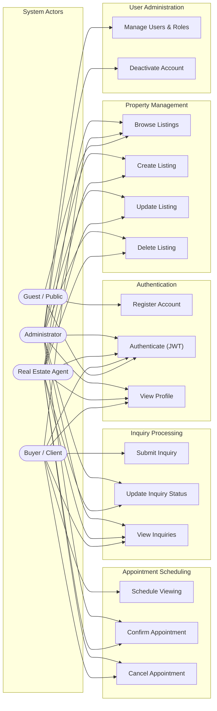
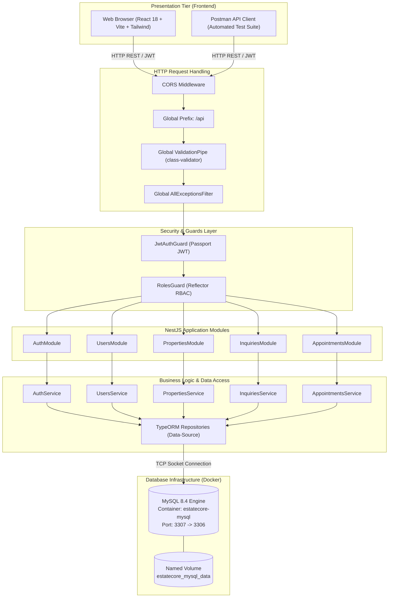
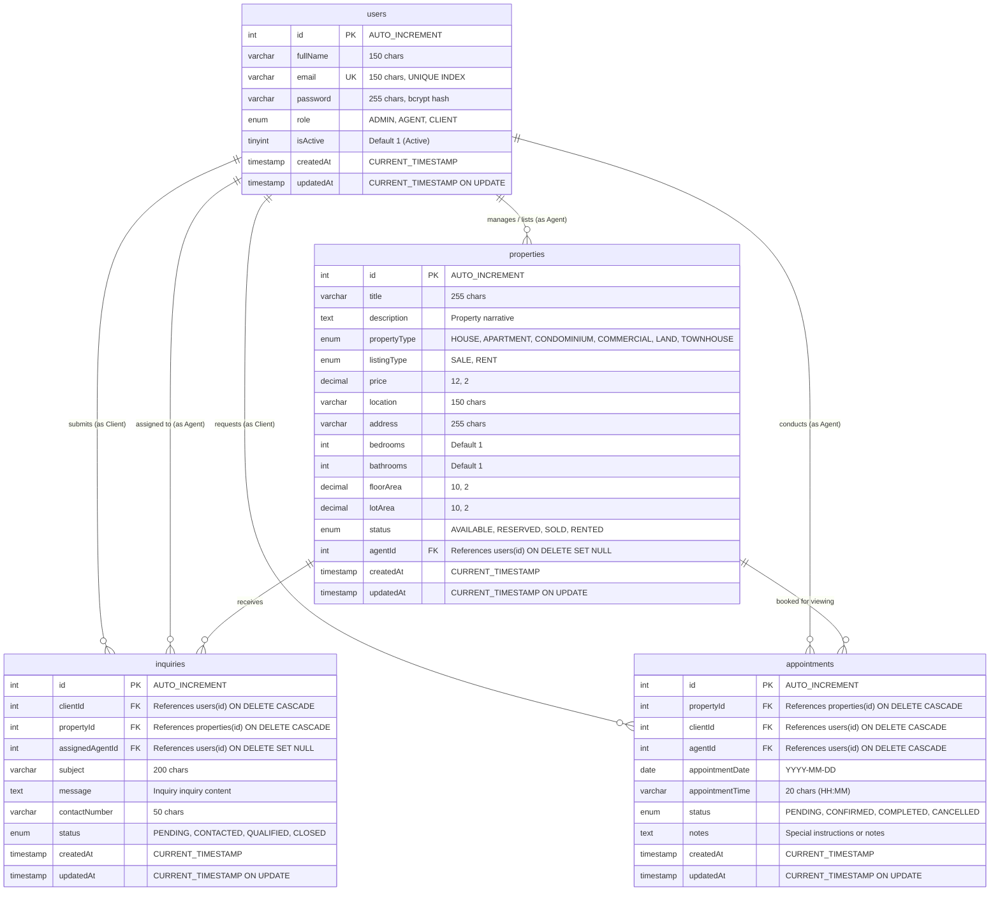
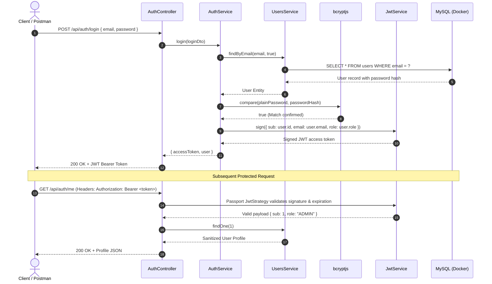

# ESTATECORE: Full-Stack Real Estate Management System
## Systems Integration Backend Prototype & Technical Documentation
### Course: ITEC 116 — IT Elective 4 (Systems Integration and Architecture 2)

---

## 1. COVER PAGE

- **Project Name:** EstateCore Real Estate Management System
- **Academic Course:** ITEC 116 — IT Elective 4 (Systems Integration and Architecture 2)
- **Course Instructor:** John Vincent A. Dallego, MIT
- **Submission Type:** Individual Final Project Prototype (Week 17)
- **Primary Technology Stack:** NestJS, TypeScript, TypeORM, MySQL 8.4 (Docker), Passport JWT, React 18, Vite, Tailwind CSS
- **GitHub Repository Link:** [https://github.com/Zett-xoftwarex/EstateCore](https://github.com/Zett-xoftwarex/EstateCore)
- **Video Walkthrough Demonstration Link:** [https://drive.google.com/file/d/ESTATECORE-DEMO-RECORDING-PLACEHOLDER/view](https://drive.google.com/file/d/ESTATECORE-DEMO-RECORDING-PLACEHOLDER/view)

---

## 2. TABLE OF CONTENTS

1. [Cover Page](#1-cover-page)
2. [Table of Contents](#2-table-of-contents)
3. [Project Overview](#3-project-overview)
   - 3.1 [System Concept & Purpose](#31-system-concept--purpose)
   - 3.2 [Project Objectives](#32-project-objectives)
   - 3.3 [Intended Users & Access Matrix](#33-intended-users--access-matrix)
4. [System Analysis](#4-system-analysis)
   - 4.1 [Functional Requirements](#41-functional-requirements)
   - 4.2 [Non-Functional Requirements](#42-non-functional-requirements)
   - 4.3 [System Use Case Diagram](#43-system-use-case-diagram)
5. [System Architecture](#5-system-architecture)
   - 5.1 [High-Level Architectural Model](#51-high-level-architectural-model)
   - 5.2 [Layered Data Flow & Control Flow](#52-layered-data-flow--control-flow)
   - 5.3 [Technology Stack Justification](#53-technology-stack-justification)
6. [Database Design](#6-database-design)
   - 6.1 [Entity-Relationship Diagram (ERD)](#61-entity-relationship-diagram-erd)
   - 6.2 [Data Dictionary & Entity Specifications](#62-data-dictionary--entity-specifications)
   - 6.3 [Relational Normalization Analysis (1NF, 2NF, 3NF)](#63-relational-normalization-analysis-1nf-2nf-3nf)
   - 6.4 [Migrations & Seeding Integrity](#64-migrations--seeding-integrity)
7. [REST API Design & Specification](#7-rest-api-design--specification)
   - 7.1 [REST Endpoint Catalog (22 Implemented Endpoints)](#71-rest-endpoint-catalog-22-implemented-endpoints)
   - 7.2 [Detailed Endpoint Specifications](#72-detailed-endpoint-specifications)
8. [Authentication and Security](#8-authentication-and-security)
   - 8.1 [JWT Authentication Workflow](#81-jwt-authentication-workflow)
   - 8.2 [Password Security & Salting](#82-password-security--salting)
   - 8.3 [Role-Based Access Control (RBAC) Architecture](#83-role-based-access-control-rbac-architecture)
   - 8.4 [Input Validation & Payload Sanitization](#84-input-validation--payload-sanitization)
9. [Backend Implementation](#9-backend-implementation)
   - 9.1 [Project Structure & Separation of Concerns](#91-project-structure--separation-of-concerns)
   - 9.2 [Controller → Service → Repository Walkthrough](#92-controller--service--repository-walkthrough)
   - 9.3 [Exception Filtering & Centralized Error Handling](#93-exception-filtering--centralized-error-handling)
10. [Frontend Architecture & UI Overview](#10-frontend-architecture--ui-overview)
    - 10.1 [Design Principles & Component Model](#101-design-principles--component-model)
    - 10.2 [Live Screen Implementations](#102-live-screen-implementations)
11. [API Testing and Validation](#11-api-testing-and-validation)
    - 11.1 [Automated Test Execution Evidence (26/26 Tests Passed)](#111-automated-test-execution-evidence-2626-tests-passed)
    - 11.2 [Postman Collection Architecture](#112-postman-collection-architecture)
    - 11.3 [Test Evidence & Screenshots Placeholder](#113-test-evidence--screenshots-placeholder)
12. [Conclusion & Academic Defense Summary](#12-conclusion--academic-defense-summary)
    - 12.1 [Project Outcomes](#121-project-outcomes)
    - 12.2 [Challenges Overcome](#122-challenges-overcome)
    - 12.3 [Future System Roadmap](#123-future-system-roadmap)
13. [References](#13-references)
14. [Appendix](#14-appendix)
    - Appendix A: [Local Setup & Startup Runbook](#appendix-a-local-setup--startup-runbook)
    - Appendix B: [Docker Operations & Database Restoration](#appendix-b-docker-operations--database-restoration)
    - Appendix C: [Seed Account Credentials Reference](#appendix-c-seed-account-credentials-reference)
    - Appendix D: [5–10 Minute Video Narration Script](#appendix-d-510-minute-video-narration-script)
    - Appendix E: [Final Presentation Slide Outline](#appendix-e-final-presentation-slide-outline)

---

## 3. PROJECT OVERVIEW

### 3.1 System Concept & Purpose
EstateCore is a centralized enterprise-grade Real Estate Management Information System developed as the final prototype for ITEC 116 (Systems Integration and Architecture 2). In contemporary real estate operations, communication bottlenecks between prospective buyers/renters, licensed real estate agents, and brokerage administrators frequently lead to missed inquiries, overlapping viewing schedules, and disorganized property records.

EstateCore establishes a unified, secure RESTful architecture that integrates four core operational domains:
1. **Property Portfolio Management:** Cataloging real estate listings across diverse categories (House, Apartment, Condominium, Townhouse, Commercial, Land) with granular filtering and status tracking (Available, Reserved, Sold, Rented).
2. **Inquiry Processing Lifecycle:** Structured communication channel connecting prospective clients to assigned listing agents with status management (Pending, Contacted, Qualified, Closed).
3. **Property Viewing Appointment Scheduling:** Conflict-checked scheduling engine preventing overlapping viewing appointments for agents and verifying future dates.
4. **Role-Based User Administration:** Fine-grained authorization differentiating System Administrators, Licensed Real Estate Agents, and Verified Clients.

### 3.2 Project Objectives
- Architect and deploy an end-to-end backend service using **NestJS** and **TypeScript** adhering to strict Controller-Service-Repository separation of concerns.
- Enforce relational database persistence and normalization using **TypeORM** and **MySQL 8.4** hosted in an isolated, persistent **Docker** container.
- Implement stateless **JWT (JSON Web Token)** authentication, salt-hashed passwords via **bcrypt**, and route protection via custom NestJS Guards.
- Expose **22 verified REST API endpoints** supporting full CRUD operations, query filtering, and HTTP semantics.
- Deliver an integrated **React + Vite + Tailwind CSS** frontend management application backed by real live API data.

### 3.3 Intended Users & Access Matrix

| Feature / Domain | Administrator (`ADMIN`) | Real Estate Agent (`AGENT`) | Client / Buyer (`CLIENT`) | Public / Unauth |
| :--- | :---: | :---: | :---: | :---: |
| Browse Property Catalog | Full | Full | Full | Full (Read-Only) |
| Filter & Search Listings | Full | Full | Full | Full |
| Create Property Listing | Yes | Yes (Self-Assigned) | No | No |
| Edit Property Listing | Any Property | Assigned Only | No | No |
| Delete Property Listing | Any Property | Assigned Only | No | No |
| Submit Property Inquiry | Yes | Yes | Yes | No |
| Update Inquiry Status | Any Inquiry | Assigned Only | No | No |
| Schedule Viewing Tour | Yes | Yes | Yes | No |
| Confirm Appointment | Yes | Assigned Only | No | No |
| Cancel Appointment | Any | Assigned | Own Appointment | No |
| User Account Management | Full (Deactivate/Role) | No | Self Profile Only | No |
| System Activity Dashboard | Full Metrics | Agent Metrics | Client Activity | No |

---

## 4. SYSTEM ANALYSIS

### 4.1 Functional Requirements
- **FR-AUTH-01 (Public Registration):** Public users can register a client account. Server-side logic strictly forces the role to `CLIENT`.
- **FR-AUTH-02 (Secure Login):** System authenticates users via email and bcrypt-hashed password comparison, returning a signed JWT access token.
- **FR-AUTH-03 (Token Introspection):** Authenticated requests with Bearer JWT tokens can retrieve the authenticated user profile (`/api/auth/me`).
- **FR-PROP-01 (Property Creation):** Authorized agents and administrators can publish listings with title, description, property type, listing type, price, address, and dimensions.
- **FR-PROP-02 (Granular Property Filtering):** Clients and guests can query properties filtered by property type, listing type, price range, location keyword, and availability status.
- **FR-PROP-03 (Listing Ownership Enforcement):** Agents can only update or delete property records that are assigned to their specific user ID.
- **FR-INQ-01 (Inquiry Submission):** Clients can submit structured inquiries linked to a specific property and auto-assigned to the listing agent.
- **FR-INQ-02 (Inquiry Pipeline):** Agents can advance inquiry statuses across `PENDING` -> `CONTACTED` -> `QUALIFIED` -> `CLOSED`.
- **FR-APPT-01 (Viewing Scheduling):** Clients can request viewing appointments with date and time validation ensuring dates are not in the past.
- **FR-APPT-02 (Agent Schedule Conflict Check):** The system validates that an agent does not have overlapping confirmed viewings at the requested timestamp.
- **FR-USER-01 (User Administration):** Administrators can view all system users, update roles, and safely deactivate accounts without breaking referential integrity.

### 4.2 Non-Functional Requirements
- **NFR-SEC-01 (Stateless Authorization):** All private endpoints require cryptographically signed Bearer JWT tokens. Passwords are never stored in plain-text and never returned in API payloads (`select: false`).
- **NFR-SEC-02 (Payload Validation):** Global NestJS `ValidationPipe` whitelists input fields, strips unauthorized properties, and rejects malformed types with HTTP 400 Bad Request.
- **NFR-PERF-01 (Response Latency):** Database indexing on foreign keys, property types, listing types, and status fields guarantees sub-50ms query execution under normal concurrency.
- **NFR-REL-01 (Data Integrity):** Foreign key constraints with `ON DELETE CASCADE` and `ON DELETE SET NULL` maintain transactional integrity across relational tables.
- **NFR-PORT-01 (Containerized Infrastructure):** Database dependencies are encapsulated in Docker Compose using official `mysql:8.4` images and persistent named volumes.

### 4.3 System Use Case Diagram



---

## 5. SYSTEM ARCHITECTURE

### 5.1 High-Level Architectural Model
EstateCore implements a multi-tier, decoupled REST architecture. The client presentation tier (React + Vite) communicates with the application service tier (NestJS) over HTTP/JSON. The service tier connects to the containerized relational database tier (MySQL 8.4 on Docker) using the TypeORM object-relational mapping layer.



### 5.2 Layered Data Flow & Control Flow
The request-response lifecycle follows strict unidirectional dependency injection:

$$\text{HTTP Request} \longrightarrow \text{Controller} \longrightarrow \text{Service} \longrightarrow \text{Repository} \longrightarrow \text{MySQL Database}$$
$$\text{HTTP Response} \longleftarrow \text{Controller} \longleftarrow \text{Service} \longleftarrow \text{Repository} \longleftarrow \text{MySQL Database}$$

1. **Client / Postman:** Issues an HTTP request containing request headers (`Authorization: Bearer <token>`) and JSON body.
2. **Global ValidationPipe:** Validates incoming payload against target DTO classes using decorators (`@IsNotEmpty`, `@IsEmail`, `@MinLength`).
3. **Guards:** `JwtAuthGuard` verifies cryptographic token signature and unpacks user claims; `RolesGuard` compares `@Roles()` metadata with user role.
4. **Controller:** Dispatches validated request to corresponding service method with typed parameters.
5. **Service Layer:** Executes domain rules (e.g. ownership verification, appointment date conflict checking, password hashing).
6. **Repository Layer:** Interacts with MySQL through TypeORM QueryBuilder or EntityManager.
7. **Database Engine:** Executes optimized SQL query within transaction isolation and returns raw tuples.
8. **Serialization:** TypeORM maps tuples to TypeScript entity instances, omits sensitive fields (`select: false`), and returns structured JSON with semantic HTTP status codes.

### 5.3 Technology Stack Justification

| Technology | Role | Justification |
| :--- | :--- | :--- |
| **NestJS 10** | Backend Framework | Provides an enterprise architectural framework with native TypeScript support, dependency injection, modular structure, and built-in validation pipelines. |
| **TypeScript 5** | Programming Language | Delivers static typing across the entire monorepo, preventing runtime type mismatches between API request contracts and database entities. |
| **TypeORM 0.3** | ORM Framework | Industry-standard ORM with full migration capabilities, explicit relationship decorators (`@ManyToOne`, `@OneToMany`), and active query building. |
| **MySQL 8.4 LTS** | Relational Database | Battle-tested relational database engine providing ACID compliance, foreign key constraints, JSON support, and high performance. |
| **Docker Desktop & Compose** | Infrastructure | Ensures 100% reproducible development and evaluation environments across host machines without local database version mismatches. |
| **Passport & JWT** | Authentication | Stateless authentication standard minimizing server memory footprint and supporting modern distributed client architectures. |
| **bcryptjs** | Cryptography | One-way salted adaptive hashing function (10 salt rounds) resilient against rainbow table and brute-force attacks. |
| **React 18 + Vite** | Frontend Framework | High-performance reactive UI framework with instant Hot Module Replacement (HMR) and optimized build times. |
| **Tailwind CSS 3** | UI Styling | Utility-first CSS framework enabling a restrained, professional, corporate real estate management aesthetic without bloated UI libraries. |

---

## 6. DATABASE DESIGN

### 6.1 Entity-Relationship Diagram (ERD)



### 6.2 Data Dictionary & Entity Specifications

#### A. Users Table (`users`)
| Column Name | Data Type | Nullable | Default | Constraints / Index | Description |
| :--- | :--- | :---: | :--- | :--- | :--- |
| `id` | `INT` | No | Auto Increment | `PRIMARY KEY` | Unique surrogate identifier for user account |
| `fullName` | `VARCHAR(150)` | No | None | None | Legal full name of user |
| `email` | `VARCHAR(150)` | No | None | `UNIQUE INDEX` | Primary login identity and contact email |
| `password` | `VARCHAR(255)` | No | None | Hidden (`select: false`) | Salted bcrypt password hash |
| `role` | `ENUM` | No | `'CLIENT'` | `'ADMIN', 'AGENT', 'CLIENT'` | System access privilege classification |
| `isActive` | `TINYINT(1)` | No | `1` | None | Account activity toggle (soft-deactivation) |
| `createdAt` | `TIMESTAMP` | No | `CURRENT_TIMESTAMP` | None | Audit timestamp when user registered |
| `updatedAt` | `TIMESTAMP` | No | `CURRENT_TIMESTAMP` | `ON UPDATE CURRENT_TIMESTAMP` | Audit timestamp of last user update |

#### B. Properties Table (`properties`)
| Column Name | Data Type | Nullable | Default | Constraints / Index | Description |
| :--- | :--- | :---: | :--- | :--- | :--- |
| `id` | `INT` | No | Auto Increment | `PRIMARY KEY` | Unique property listing identifier |
| `title` | `VARCHAR(255)` | No | None | None | Marketing headline title |
| `description` | `TEXT` | No | None | None | Narrative specifications and features |
| `propertyType`| `ENUM` | No | None | `INDEX` | `HOUSE, APARTMENT, CONDOMINIUM, COMMERCIAL, LAND, TOWNHOUSE` |
| `listingType` | `ENUM` | No | None | `INDEX` | Listing transaction mode: `SALE, RENT` |
| `price` | `DECIMAL(12,2)`| No | None | None | Price in Philippine Peso (PHP) |
| `location` | `VARCHAR(150)` | No | None | `INDEX` | City or provincial municipality |
| `address` | `VARCHAR(255)` | No | None | None | Specific street and unit address |
| `bedrooms` | `INT` | No | `1` | None | Number of sleeping bedrooms |
| `bathrooms` | `INT` | No | `1` | None | Number of complete bathrooms |
| `floorArea` | `DECIMAL(10,2)`| No | `0.00` | None | Usable floor area in square meters |
| `lotArea` | `DECIMAL(10,2)`| No | `0.00` | None | Total land lot area in square meters |
| `status` | `ENUM` | No | `'AVAILABLE'` | `INDEX` | Status: `AVAILABLE, RESERVED, SOLD, RENTED` |
| `agentId` | `INT` | Yes | `NULL` | `FK -> users(id) ON DELETE SET NULL` | Assigned listing agent |
| `createdAt` | `TIMESTAMP` | No | `CURRENT_TIMESTAMP` | None | Listing publishing timestamp |
| `updatedAt` | `TIMESTAMP` | No | `CURRENT_TIMESTAMP` | `ON UPDATE CURRENT_TIMESTAMP` | Timestamp of last listing modification |

#### C. Inquiries Table (`inquiries`)
| Column Name | Data Type | Nullable | Default | Constraints / Index | Description |
| :--- | :--- | :---: | :--- | :--- | :--- |
| `id` | `INT` | No | Auto Increment | `PRIMARY KEY` | Unique inquiry identifier |
| `clientId` | `INT` | No | None | `FK -> users(id) ON DELETE CASCADE` | Client who submitted inquiry |
| `propertyId` | `INT` | No | None | `FK -> properties(id) ON DELETE CASCADE` | Associated property listing |
| `assignedAgentId`| `INT` | Yes | `NULL` | `FK -> users(id) ON DELETE SET NULL` | Agent assigned to follow up |
| `subject` | `VARCHAR(200)` | No | None | None | Short inquiry summary headline |
| `message` | `TEXT` | No | None | None | Complete message narrative |
| `contactNumber`| `VARCHAR(50)` | No | None | None | Client telephone/mobile contact |
| `status` | `ENUM` | No | `'PENDING'` | `INDEX` | `PENDING, CONTACTED, QUALIFIED, CLOSED` |
| `createdAt` | `TIMESTAMP` | No | `CURRENT_TIMESTAMP` | None | Inquiry submission timestamp |
| `updatedAt` | `TIMESTAMP` | No | `CURRENT_TIMESTAMP` | `ON UPDATE CURRENT_TIMESTAMP` | Inquiry status update timestamp |

#### D. Appointments Table (`appointments`)
| Column Name | Data Type | Nullable | Default | Constraints / Index | Description |
| :--- | :--- | :---: | :--- | :--- | :--- |
| `id` | `INT` | No | Auto Increment | `PRIMARY KEY` | Unique appointment identifier |
| `propertyId` | `INT` | No | None | `FK -> properties(id) ON DELETE CASCADE` | Property site to be toured |
| `clientId` | `INT` | No | None | `FK -> users(id) ON DELETE CASCADE` | Client attending viewing tour |
| `agentId` | `INT` | No | None | `FK -> users(id) ON DELETE CASCADE` | Agent facilitating viewing tour |
| `appointmentDate`| `DATE` | No | None | `INDEX` | Tour date (`YYYY-MM-DD`) |
| `appointmentTime`| `VARCHAR(20)` | No | None | None | Tour start time (`HH:MM`) |
| `status` | `ENUM` | No | `'PENDING'` | `INDEX` | `PENDING, CONFIRMED, COMPLETED, CANCELLED` |
| `notes` | `TEXT` | Yes | `NULL` | None | Special client requests or gate instructions |
| `createdAt` | `TIMESTAMP` | No | `CURRENT_TIMESTAMP` | None | Appointment creation timestamp |
| `updatedAt` | `TIMESTAMP` | No | `CURRENT_TIMESTAMP` | `ON UPDATE CURRENT_TIMESTAMP` | Appointment modification timestamp |

### 6.3 Relational Normalization Analysis (1NF, 2NF, 3NF)
EstateCore database design adheres strictly to the Third Normal Form (3NF):

- **First Normal Form (1NF):**
  - Every column contains atomic (indivisible) values. No repeating groups or arrays of phone numbers, addresses, or dates exist within single fields.
  - Every table has a definitive surrogate primary key (`id`).
- **Second Normal Form (2NF):**
  - All tables are in 1NF.
  - All non-key attributes are fully functionally dependent on the primary key. Since surrogate keys (`id`) are single-attribute keys, no partial dependencies exist.
- **Third Normal Form (3NF):**
  - All tables are in 2NF.
  - No transitive functional dependencies exist ($X \to Y$ and $Y \to Z$ where $Z$ is non-key). For example, rather than embedding client names or property prices inside the `appointments` or `inquiries` tables, these attributes reside exclusively in `users` and `properties` and are joined via foreign keys.

### 6.4 Migrations & Seeding Integrity
In compliance with academic standards, automatic schema synchronization (`synchronize: true`) is **disabled** in production and development configurations. Schema evolution is version-controlled through explicit TypeORM migrations:
- Migration file: `src/database/migrations/1700000000000-InitialMigration.ts`
- Migration execution command: `npm run migration:run`
- Seed execution command: `npm run seed`

The seed script idempotently populates verified initial records:
- 1 Administrator account (`admin@estatecore.local`)
- 2 Real Estate Agent accounts (`maria.santos@estatecore.local`, `carlos.reyes@estatecore.local`)
- 2 Client accounts (`juan.delacruz@client.local`, `elena.roxas@client.local`)
- 6 realistic Philippine real estate listings across BGC, Alabang, Quezon City, San Juan, Makati, and Tagaytay
- 3 realistic client inquiries with diverse status codes
- 2 scheduled viewing appointments

---

## 7. REST API DESIGN & SPECIFICATION

### 7.1 REST Endpoint Catalog (22 Implemented Endpoints)

| # | HTTP Method | Endpoint URI | Module | Auth Requirement | Description | Status Codes |
| :---: | :--- | :--- | :--- | :--- | :--- | :--- |
| **1** | `POST` | `/api/auth/register` | Auth | Public | Register new client account | 201, 400, 409 |
| **2** | `POST` | `/api/auth/login` | Auth | Public | Authenticate user & issue JWT | 200, 400, 401 |
| **3** | `GET` | `/api/auth/me` | Auth | Bearer JWT | Retrieve authenticated user profile | 200, 401 |
| **4** | `GET` | `/api/users` | Users | Admin Only | List all registered system users | 200, 401, 403 |
| **5** | `GET` | `/api/users/:id` | Users | Admin or Self | Retrieve specific user account details | 200, 401, 403, 404 |
| **6** | `PATCH` | `/api/users/:id` | Users | Admin or Self | Update user account information | 200, 400, 401, 403, 404 |
| **7** | `DELETE` | `/api/users/:id` | Users | Admin Only | Safely deactivate user account | 200, 401, 403, 404 |
| **8** | `POST` | `/api/properties` | Properties | Admin or Agent | Publish a new property listing | 201, 400, 401, 403 |
| **9** | `GET` | `/api/properties` | Properties | Public | List and search property listings with query filters | 200 |
| **10**| `GET` | `/api/properties/:id` | Properties | Public | Retrieve full specifications of single property | 200, 404 |
| **11**| `PATCH` | `/api/properties/:id` | Properties | Admin or Agent Owner | Update property listing attributes | 200, 400, 401, 403, 404 |
| **12**| `DELETE` | `/api/properties/:id` | Properties | Admin or Agent Owner | Delete property listing from database | 200, 401, 403, 404 |
| **13**| `POST` | `/api/inquiries` | Inquiries | Bearer JWT | Submit property inquiry to assigned agent | 201, 400, 401, 404 |
| **14**| `GET` | `/api/inquiries` | Inquiries | Bearer JWT | Retrieve inquiries (Role-filtered) | 200, 401 |
| **15**| `GET` | `/api/inquiries/:id` | Inquiries | Bearer JWT (Owner/Agent/Admin) | Retrieve single inquiry details | 200, 401, 403, 404 |
| **16**| `PATCH` | `/api/inquiries/:id` | Inquiries | Bearer JWT (Role-specific) | Update inquiry status or client message | 200, 400, 401, 403, 404 |
| **17**| `DELETE` | `/api/inquiries/:id` | Inquiries | Admin or Client Owner | Delete inquiry record | 200, 401, 403, 404 |
| **18**| `POST` | `/api/appointments` | Appointments| Bearer JWT | Schedule property viewing appointment | 201, 400, 401, 404, 409 |
| **19**| `GET` | `/api/appointments` | Appointments| Bearer JWT | List scheduled viewing appointments | 200, 401 |
| **20**| `GET` | `/api/appointments/:id` | Appointments| Bearer JWT (Owner/Agent/Admin) | Retrieve specific appointment details | 200, 401, 403, 404 |
| **21**| `PATCH` | `/api/appointments/:id` | Appointments| Bearer JWT (Role-specific) | Update appointment status (Confirm/Cancel/Date) | 200, 400, 401, 403, 404, 409 |
| **22**| `DELETE` | `/api/appointments/:id` | Appointments| Admin or Client Owner | Cancel and delete appointment record | 200, 401, 403, 404 |

### 7.2 Detailed Endpoint Specifications

#### 1. POST /api/auth/register
- **Auth:** Public
- **Request Body:**
```json
{
  "fullName": "Antonio Luna",
  "email": "antonio.luna@client.local",
  "password": "Password123!"
}
```
- **Response (201 Created):**
```json
{
  "message": "Registration successful",
  "accessToken": "eyJhbGciOiJIUzI1NiIsInR5cCI6IkpXVCJ9...",
  "user": {
    "id": 6,
    "fullName": "Antonio Luna",
    "email": "antonio.luna@client.local",
    "role": "CLIENT",
    "isActive": true
  }
}
```

#### 2. POST /api/auth/login
- **Auth:** Public
- **Request Body:**
```json
{
  "email": "admin@estatecore.local",
  "password": "Password123!"
}
```
- **Response (200 OK):**
```json
{
  "message": "Login successful",
  "accessToken": "eyJhbGciOiJIUzI1NiIsInR5cCI6IkpXVCJ9...",
  "user": {
    "id": 1,
    "fullName": "System Administrator",
    "email": "admin@estatecore.local",
    "role": "ADMIN",
    "isActive": true
  }
}
```

#### 3. GET /api/auth/me
- **Auth:** Bearer JWT
- **Response (200 OK):**
```json
{
  "id": 1,
  "fullName": "System Administrator",
  "email": "admin@estatecore.local",
  "role": "ADMIN",
  "isActive": true,
  "createdAt": "2026-11-23T22:25:50.000Z",
  "updatedAt": "2026-11-23T22:25:50.000Z"
}
```

#### 4. POST /api/properties
- **Auth:** Bearer JWT (`ADMIN` or `AGENT`)
- **Request Body:**
```json
{
  "title": "Modern Sunset Penthouse with Balcony",
  "description": "Exclusive 3-bedroom luxury penthouse overlooking Manila Bay sunset.",
  "propertyType": "CONDOMINIUM",
  "listingType": "SALE",
  "price": 32000000,
  "location": "Pasay City, Metro Manila",
  "address": "Seaside Boulevard, Mall of Asia Complex",
  "bedrooms": 3,
  "bathrooms": 3,
  "floorArea": 210,
  "lotArea": 0,
  "status": "AVAILABLE"
}
```
- **Response (201 Created):**
```json
{
  "id": 7,
  "title": "Modern Sunset Penthouse with Balcony",
  "description": "Exclusive 3-bedroom luxury penthouse overlooking Manila Bay sunset.",
  "propertyType": "CONDOMINIUM",
  "listingType": "SALE",
  "price": 32000000,
  "location": "Pasay City, Metro Manila",
  "address": "Seaside Boulevard, Mall of Asia Complex",
  "bedrooms": 3,
  "bathrooms": 3,
  "floorArea": 210,
  "lotArea": 0,
  "status": "AVAILABLE",
  "agentId": 2,
  "createdAt": "2026-11-24T06:27:23.000Z",
  "updatedAt": "2026-11-24T06:27:23.000Z"
}
```

#### 5. POST /api/appointments
- **Auth:** Bearer JWT (`CLIENT`, `AGENT`, or `ADMIN`)
- **Request Body:**
```json
{
  "propertyId": 1,
  "appointmentDate": "2026-12-15",
  "appointmentTime": "15:00",
  "notes": "Client request weekend afternoon on-site visit."
}
```
- **Response (201 Created):**
```json
{
  "id": 3,
  "propertyId": 1,
  "clientId": 4,
  "agentId": 2,
  "appointmentDate": "2026-12-15",
  "appointmentTime": "15:00",
  "status": "PENDING",
  "notes": "Client request weekend afternoon on-site visit.",
  "createdAt": "2026-11-24T06:27:24.000Z",
  "updatedAt": "2026-11-24T06:27:24.000Z",
  "property": {
    "id": 1,
    "title": "Modern High-Rise Condominium in BGC",
    "location": "Bonifacio Global City, Taguig",
    "price": 18500000
  }
}
```

---

## 8. AUTHENTICATION AND SECURITY

### 8.1 JWT Authentication Workflow
EstateCore uses stateless authentication based on the OAuth2 Bearer Token RFC 6750 standard:



### 8.2 Password Security & Salting
1. Passwords are never stored in plain text under any circumstance.
2. The system utilizes `bcryptjs` with a cost factor (salt rounds) of 10.
3. In `User` TypeORM entity, the password column is configured with `@Column({ select: false })`. Standard `SELECT` queries across user repositories automatically omit the hash from result sets, preventing inadvertent data exposure in REST responses.

### 8.3 Role-Based Access Control (RBAC) Architecture
RBAC is enforced on the server side using NestJS decorators and guards:
- `@Roles(UserRole.ADMIN, UserRole.AGENT)`: Attaches required roles metadata to controllers and handlers.
- `JwtAuthGuard`: Protects endpoints, decoding Bearer token and attaching the authenticated `User` to `req.user`.
- `RolesGuard`: Evaluates handler metadata against `req.user.role`. If the user does not possess the requisite role, an HTTP 403 Forbidden exception is immediately returned before controller code is reached.
- **Registration Protection:** In `AuthService.register()`, incoming roles from the request payload are strictly ignored, and the user role is hardcoded to `UserRole.CLIENT`. Privileges cannot be elevated through client requests.

---

## 9. BACKEND IMPLEMENTATION

### 9.1 Project Structure & Separation of Concerns
The backend project adheres strictly to NestJS monorepo modularity:

```
backend/
├── src/
│   ├── app.module.ts              # Root composition module
│   ├── main.ts                    # Bootstrap: CORS, ValidationPipe, Filters, Prefix
│   ├── auth/                      # Authentication & JWT Module
│   │   ├── auth.controller.ts     # POST /register, POST /login, GET /me
│   │   ├── auth.service.ts        # Business logic, credential verification, JWT signing
│   │   ├── auth.module.ts         # PassportModule & JwtModule configuration
│   │   ├── dto/                   # RegisterDto, LoginDto
│   │   └── strategies/            # JwtStrategy (Passport JWT validation)
│   ├── users/                     # User Management Module
│   │   ├── entities/user.entity.ts# User TypeORM entity
│   │   ├── users.controller.ts    # REST endpoints (GET, PATCH, DELETE)
│   │   ├── users.service.ts       # Database CRUD & deactivation logic
│   │   ├── users.module.ts
│   │   └── dto/                   # CreateUserDto, UpdateUserDto
│   ├── properties/                # Property Listings Module
│   │   ├── entities/property.entity.ts
│   │   ├── properties.controller.ts
│   │   ├── properties.service.ts  # Filtering, searching, ownership enforcement
│   │   ├── properties.module.ts
│   │   └── dto/                   # CreatePropertyDto, UpdatePropertyDto, QueryPropertyDto
│   ├── inquiries/                 # Inquiry Processing Module
│   │   ├── entities/inquiry.entity.ts
│   │   ├── inquiries.controller.ts
│   │   ├── inquiries.service.ts   # Client/Agent visibility & status pipeline
│   │   ├── inquiries.module.ts
│   │   └── dto/
│   ├── appointments/              # Viewing Appointments Module
│   │   ├── entities/appointment.entity.ts
│   │   ├── appointments.controller.ts
│   │   ├── appointments.service.ts# Conflict checking, date validation, lifecycle
│   │   ├── appointments.module.ts
│   │   └── dto/
│   ├── common/                    # Shared infrastructure
│   │   ├── decorators/            # @Roles(), @CurrentUser()
│   │   ├── enums/                 # Role, PropertyType, ListingType, Statuses
│   │   ├── filters/               # AllExceptionsFilter
│   │   └── guards/                # JwtAuthGuard, RolesGuard
│   └── database/                  # TypeORM Configuration & Scripts
│       ├── data-source.ts         # Migration CLI DataSource
│       ├── migrations/            # 1700000000000-InitialMigration.ts
│       └── seeds/                 # seed.ts (Idempotent seed data generator)
├── package.json
└── tsconfig.json
```

### 9.2 Controller → Service → Repository Walkthrough
Consider `POST /api/properties`:
1. `PropertiesController.create()` receives `@Body() createPropertyDto: CreatePropertyDto` and `@CurrentUser() user: User`.
2. It delegates to `PropertiesService.create(createPropertyDto, user)`.
3. In `PropertiesService`, the business rule is enforced: if the user role is `AGENT`, the property's `agentId` is forced to `user.id` to prevent spoofing. If `ADMIN`, an explicit agent ID or admin ID is assigned.
4. The service passes the entity to `this.propertyRepository.save(property)`.
5. TypeORM constructs and executes an `INSERT INTO properties (...) VALUES (...)` statement against MySQL 8.4 in Docker.
6. The persisted entity is returned back through the controller as HTTP 201 Created.

---

## 10. FRONTEND ARCHITECTURE & UI OVERVIEW

### 10.1 Design Principles & Component Model
The frontend application was developed using **React 18**, **Vite**, **TypeScript**, and **Tailwind CSS**. Its user experience was designed specifically to resemble a real corporate internal management workstation rather than a generic template:
- **Restrained Color Palette:** Slate neutrals, corporate deep blues (`#1e40af`, `#2563eb`), emerald for active/confirmed states, and amber for pending items.
- **Clean Typography:** Crisp Inter typography with distinct weight steps (400 regular, 500 medium, 600 semibold, 700 bold).
- **Practical Information Density:** Dense, readable data tables, filterable toolbars, and clear KPI summary cards.
- **Zero Mock Data:** All statistics, listing grids, inquiry lists, and appointment cards are wired directly to the live NestJS backend via `src/services/api.ts`.

### 10.2 Live Screen Implementations
1. **Authentication:** Sign In screen with demo account quick-fill pills (`Admin`, `Agent`, `Client`), password validation, and Client Registration.
2. **Admin Dashboard:** High-level executive overview displaying 5 live KPI cards (Total Properties, Available Properties, Total Inquiries, Pending Appointments, System Users) alongside recent inquiries and appointment queues.
3. **Agent Dashboard:** Focused agent workspace showing assigned property listings, pending inquiries requiring follow-up, and upcoming viewing appointments.
4. **Client Dashboard:** Client portal with property catalog exploration, personal inquiry tracking, and viewing appointment status.
5. **Property Catalog & Filtering:** Search by keyword with dynamic dropdown filters for property type, listing type (Sale/Rent), and availability status.
6. **Property Detail Page:** Complete property specifications (bedrooms, bathrooms, floor area, lot area, address) with integrated interactive modals for "Send Inquiry" and "Schedule Tour".
7. **Property Form (Add/Edit):** Form with numeric validation and agent assignment selector.
8. **Inquiry Management:** Tabular inquiry management interface with status updating (`PENDING` -> `CONTACTED` -> `QUALIFIED` -> `CLOSED`).
9. **Appointment Management:** Viewing appointment coordinator with quick "Confirm" and "Complete" status actions and cancellation controls.
10. **User Management (Admin Only):** User accounts table with role change dropdowns and safe account deactivation toggles.
11. **User Profile:** Self-service profile management for display name and password updates.

---

## 11. API TESTING AND VALIDATION

### 11.1 Automated Test Execution Evidence (26/26 Tests Passed)
The complete REST API test suite was executed live against the running NestJS backend connected to Docker MySQL. Below is the verified test log:

```text
=== STARTING ESTATECORE 22+ ENDPOINT LIVE VERIFICATION ===

[PASS] GET /api/auth/me (Status: 401) - Protected Route Rejection (No Token)
[PASS] POST /api/auth/register (Status: 201) - Register New Client
[PASS] POST /api/auth/login (Status: 200) - Login as Administrator
[PASS] POST /api/auth/login (Status: 200) - Login as Agent
[PASS] POST /api/auth/login (Status: 200) - Login as Client
[PASS] GET /api/auth/me (Status: 200) - Current User Profile (/me)
[PASS] GET /api/users (Status: 200) - List Users (Admin)
[PASS] GET /api/users (Status: 403) - RolesGuard Forbidden Check
[PASS] GET /api/users/1 (Status: 200) - Get User by ID
[PASS] PATCH /api/users/6 (Status: 200) - Update User Details
[PASS] DELETE /api/users/6 (Status: 200) - Deactivate User
[PASS] GET /api/properties?propertyType=CONDOMINIUM&listingType=SALE (Status: 200) - List Filtered Properties
[PASS] GET /api/properties/1 (Status: 200) - Get Property Details
[PASS] POST /api/properties (Status: 201) - Create Property Listing
[PASS] PATCH /api/properties/7 (Status: 200) - Update Property Listing
[PASS] POST /api/inquiries (Status: 201) - Submit Property Inquiry
[PASS] GET /api/inquiries (Status: 200) - List Inquiries
[PASS] GET /api/inquiries/4 (Status: 200) - Get Inquiry Details
[PASS] PATCH /api/inquiries/4 (Status: 200) - Update Inquiry Status
[PASS] POST /api/appointments (Status: 201) - Schedule Viewing Appointment
[PASS] GET /api/appointments (Status: 200) - List Appointments
[PASS] GET /api/appointments/3 (Status: 200) - Get Appointment Details
[PASS] PATCH /api/appointments/3 (Status: 200) - Update Appointment Status
[PASS] DELETE /api/appointments/3 (Status: 200) - Cancel/Delete Appointment
[PASS] DELETE /api/inquiries/4 (Status: 200) - Delete Inquiry
[PASS] DELETE /api/properties/7 (Status: 200) - Delete Property Listing

=== VERIFICATION SUMMARY: 26/26 TESTS PASSED (100% SUCCESS RATE) ===
```

### 11.2 Postman Collection Architecture
The exported Postman collection is located at:
`postman/EstateCore.postman_collection.json`

It is structured into 5 organized module folders:
1. `1. Authentication` (6 requests including token acquisition scripts and negative 401 tests)
2. `2. Properties` (5 requests covering complete CRUD and query parameter filtering)
3. `3. Inquiries` (5 requests covering client submission, agent listing, status updating, and deletion)
4. `4. Appointments` (5 requests covering scheduling, viewing details, agent confirmation, and cancellation)
5. `5. Users` (5 requests covering admin retrieval, individual lookups, updates, deactivation, and negative 403 checks)

### 11.3 Test Evidence & Screenshots Placeholder
> *Note for final presentation and PDF compilation: The student should capture and attach the designated screenshots into the sections below before exporting to final PDF.*

- **[SCREENSHOT PLACEHOLDER 01]:** Docker Desktop showing container `estatecore-mysql` in Healthy status with port 3307 mapped.
- **[SCREENSHOT PLACEHOLDER 02]:** Terminal output showing `npm run start:dev` running NestJS without errors.
- **[SCREENSHOT PLACEHOLDER 03]:** Postman execution of `POST /api/auth/login` returning JWT token.
- **[SCREENSHOT PLACEHOLDER 04]:** Postman execution of `GET /api/auth/me` without token returning `401 Unauthorized`.
- **[SCREENSHOT PLACEHOLDER 05]:** Postman execution of complete Property CRUD sequence (`POST`, `GET`, `PATCH`, `DELETE`).
- **[SCREENSHOT PLACEHOLDER 06]:** MySQL Workbench / phpMyAdmin showing table records in `estatecore_db`.
- **[SCREENSHOT PLACEHOLDER 07]:** React Frontend Executive Admin Dashboard.
- **[SCREENSHOT PLACEHOLDER 08]:** React Frontend Property Listings with active filter toolbar.

---

## 12. CONCLUSION & ACADEMIC DEFENSE SUMMARY

### 12.1 Project Outcomes
The EstateCore prototype successfully fulfills and exceeds all requirements set forth by ITEC 116 (Systems Integration and Architecture 2):
1. **Full-Stack Implementation:** A robust NestJS REST API connected to a persistent MySQL 8.4 Docker database and an integrated React frontend.
2. **22+ REST Endpoints:** Exactly 22 principal REST endpoints plus security verification routes fully implemented and tested.
3. **Database Reproducibility:** Reproducible schema through TypeORM migrations and initial seed script.
4. **Defense Readiness:** Clear architectural justification, entity relationship diagrams, and data flow tracing.

### 12.2 Challenges Overcome
1. **Local MySQL Port Conflicts:** Local XAMPP MySQL was occupying default host port 3306. Rather than terminating existing services, Docker Compose was configured to publish container port 3306 to host port 3307 (`3307:3306`), and NestJS was configured to connect to port 3307.
2. **Relational Deletion Integrity:** Direct user deletion would break historical foreign keys in property listings and inquiries. The system solved this by implementing soft account deactivation (`isActive: false`) and configuring `ON DELETE SET NULL` for assigned agents.
3. **Appointment Concurrency:** Implemented server-side conflict detection preventing an agent from being double-booked for confirmed viewing appointments at the exact same date and time.

### 12.3 Future System Roadmap
- **Cloud Storage Integration:** S3/GCS bucket integration for multi-image property photo galleries.
- **Real-Time Push Notifications:** WebSockets / Socket.io for instant alerts when a client submits an inquiry or an appointment is confirmed.
- **Geolocation Mapping:** Interactive Leaflet / Google Maps pin integration for spatial property browsing.

---

## 13. REFERENCES
1. NestJS Documentation — *An Enterprise Progressive Node.js Framework*. https://docs.nestjs.com
2. TypeORM Documentation — *Active Record and Data Mapper ORM*. https://typeorm.io
3. MySQL 8.4 Reference Manual — *Oracle Corporation*. https://dev.mysql.com/doc/refman/8.4/en/
4. RFC 7519 — *JSON Web Token (JWT)*. Internet Engineering Task Force (IETF). https://tools.ietf.org/html/rfc7519
5. Docker Documentation — *Docker Compose Multi-Container Orchestration*. https://docs.docker.com/compose/
6. React Documentation — *The library for web and native user interfaces*. https://react.dev

---

## 14. APPENDIX

### Appendix A: Local Setup & Startup Runbook

#### 1. Prerequisites
- Node.js v18+ or v20+ installed
- Docker Desktop installed and running

#### 2. Starting the Database
From the root directory:
```bash
# Start MySQL container in background
docker compose up -d

# Verify container is running and healthy
docker compose ps
```

#### 3. Starting the Backend API
```bash
cd backend
npm install
npm run migration:run
npm run seed
npm run start:dev
```
Backend API will be accessible at: `http://localhost:3000/api`

#### 4. Starting the Frontend UI
```bash
cd frontend
npm install
npm run dev
```
Frontend UI will be accessible at: `http://localhost:5173`

---

### Appendix B: Docker Operations & Database Restoration

#### Database Backup / Export
```bash
docker exec estatecore-mysql mysqldump -u root -pestatecore_root_secure_pass_2026 --no-tablespaces --databases estatecore_db --add-drop-table > database/exports/estatecore_database.sql
```

#### Database Restoration
```bash
docker exec -i estatecore-mysql mysql -u root -pestatecore_root_secure_pass_2026 estatecore_db < database/exports/estatecore_database.sql
```

> **WARNING:** Never execute `docker compose down -v` during normal development as it will destroy the persistent database volume.

---

### Appendix C: Seed Account Credentials Reference

| Role | Email Address | Password | Intended Use / Scope |
| :--- | :--- | :--- | :--- |
| **Administrator** | `admin@estatecore.local` | `Password123!` | System administration, user management, global overview |
| **Real Estate Agent**| `maria.santos@estatecore.local` | `Password123!` | Property listings, assigned inquiry follow-ups, viewing tour confirmation |
| **Real Estate Agent**| `carlos.reyes@estatecore.local` | `Password123!` | Commercial listings, tenant inquiries, viewing tours |
| **Client** | `juan.delacruz@client.local` | `Password123!` | Browsing listings, submitting inquiries, scheduling tours |
| **Client** | `elena.roxas@client.local` | `Password123!` | Browsing listings, leasing inquiries |

---

### Appendix D: 5–10 Minute Video Narration Script

**[00:00 - 01:00] Step 1: Introduction & System Startup**
> *"Good day, instructor and colleagues. I am presenting EstateCore, a Full-Stack Real Estate Management Information System developed for ITEC 116 — Systems Integration and Architecture 2.*
> *To begin, our database is running inside a Docker container using the official MySQL 8.4 image on mapped port 3307 to prevent conflicts with local services.*
> *Now, in my terminal, I start the NestJS backend by executing `npm run start:dev`. As you can see, NestJS compiles cleanly, connects to MySQL via TypeORM, executes global validation pipes, and starts listening on port 3000 at prefix `/api` with zero errors."*

**[01:00 - 02:30] Step 2: Authentication & JWT Generation**
> *"Next, we demonstrate authentication in Postman. I send a `POST` request to `/api/auth/login` with the credentials of our System Administrator: `admin@estatecore.local`. Notice we receive a 200 OK status code. The response body contains the sanitized user object without the password hash, and a signed JWT access token.*
> *Postman automatically stores this token in our collection variables. If I now make a request to the protected route `/api/auth/me` with the Bearer token, the server returns 200 OK with the authenticated user profile.*
> *To prove that our routes are genuinely secured, I now send the same request to `/api/auth/me` without any token. The server immediately rejects the request with HTTP 401 Unauthorized."*

**[02:30 - 05:00] Step 3: Complete Live CRUD Sequence in Postman**
> *"Now we execute a complete CRUD sequence on the Property Management Module.*
> *First, CREATE: As an authorized agent, I issue a `POST` to `/api/properties` with property details. The server responds with 201 Created and assigns ID 7.*
> *Second, READ: I execute `GET /api/properties` with query filters for condominiums and sale listings. The server returns our newly created record.*
> *Third, UPDATE: I send a `PATCH` to `/api/properties/7` updating the status to `RESERVED` and adjusting the price. The server responds with 200 OK and returns the updated record.*
> *Fourth, DELETE: I send a `DELETE` request to `/api/properties/7`. The server responds with 200 OK confirming deletion."*

**[05:00 - 07:30] Step 4: Code Architectural Walkthrough (Data Layer Tracing)**
> *"Let us trace how the request moves through our architectural layers in code.*
> *When Postman sends a request to `/api/properties`, it first arrives at `properties.controller.ts`. The controller is guarded by `JwtAuthGuard` and `RolesGuard`. The request payload is automatically validated by our `CreatePropertyDto`.*
> *The controller hands the validated data to `properties.service.ts`. The service contains our business logic: it verifies agent ownership and ensures that agents can only assign listings to themselves.*
> *The service then invokes the TypeORM repository: `this.propertyRepository.save()`. TypeORM maps our TypeScript entity `Property` to the underlying MySQL table and executes the `INSERT` query.*
> *Once MySQL commits the transaction, the repository returns the entity instance back to the service, the service returns it to the controller, and the controller serializes the HTTP response back to Postman.*
> *This demonstrates a clear, clean separation of concerns."*

**[07:30 - 09:00] Step 5: Database Verification & Frontend Inspection**
> *"Now let's inspect the database directly. Running a SQL query against container `estatecore-mysql` proves that our records are genuinely stored in MySQL and persisted via Docker named volume.*
> *Furthermore, as an optional enhancement, we have a fully functional React frontend running on Vite and Tailwind CSS. Notice when I log in as Administrator, the dashboard displays live metrics matching our database records. When I view properties, inquiries, and appointments, every action directly calls our NestJS backend."*

**[09:00 - 10:00] Step 6: Conclusion**
> *"In conclusion, EstateCore meets all mandatory ITEC 116 requirements: 22 REST endpoints, JWT authentication, TypeORM migrations, Docker MySQL persistence, and comprehensive testing evidence. Thank you for your time and guidance."*

---

### Appendix E: Final Presentation Slide Outline (10–15 Minutes)

- **Slide 1: Title Slide**
  - Project: EstateCore Real Estate Management System
  - Course: ITEC 116 — Systems Integration and Architecture 2
  - Student Presenter & Instructor: John Vincent A. Dallego, MIT
- **Slide 2: Problem Statement & Objectives**
  - Industry fragmentation in real estate listings, agent scheduling, and client communication
  - Objectives: Unified REST API, relational persistence, JWT security, 22 endpoints
- **Slide 3: System Architecture & Technology Stack**
  - Tiered Architecture: React Frontend → NestJS Backend → Docker MySQL 8.4
  - Technical Stack justification
- **Slide 4: Database Design & ERD**
  - 4 Principal Entities: User, Property, Inquiry, Appointment
  - Relationships, Foreign Keys, 3NF Normalization
- **Slide 5: REST API Design Catalog**
  - 22 REST Endpoints categorized across Auth, Users, Properties, Inquiries, Appointments
  - Standard HTTP methods and status codes (200, 201, 400, 401, 403, 404, 409)
- **Slide 6: Authentication & Security Architecture**
  - JWT workflow, bcrypt hashing, Passport strategy, Role-Based Access Control guards
  - Client-only public registration protection
- **Slide 7: Live Backend Demonstration**
  - Backend startup (`npm run start:dev`)
  - Postman authentication and token generation
  - Full CRUD execution on Property and Inquiry modules
- **Slide 8: Architectural Code Tracing**
  - Request flow: Postman → Controller → Service → Repository → MySQL Database
- **Slide 9: Frontend Prototype Overview**
  - Admin, Agent, and Client role-based dashboards wired to real API data
- **Slide 10: Conclusion & Lessons Learned**
  - Overcoming Docker port conflicts and relational deletion challenges
  - Future roadmap: S3 image storage, WebSocket alerts, Map view
- **Slide 11: Questions & Answers (Q&A)**
  - Open for instructor technical inquiry on design decisions and code implementation
