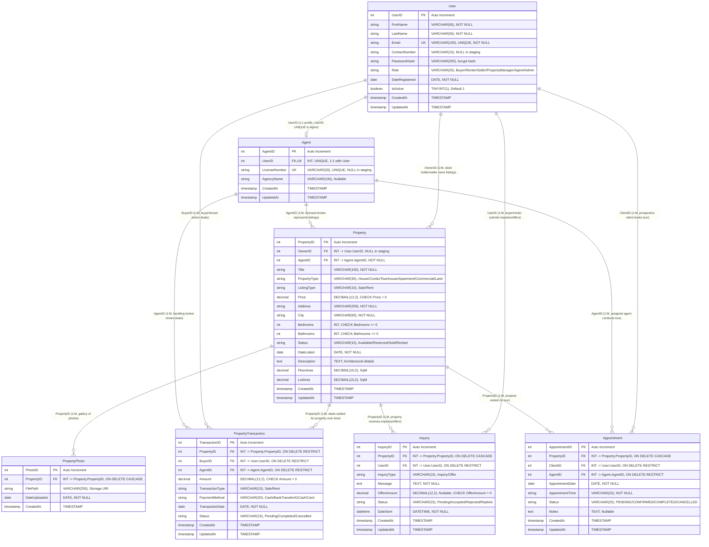

# EstateCore — Entity-Relationship Diagram (ERD) & Relational Architecture (Revised)
### Verified Relational Schema Aligned with `estatecire.pdf` & Real-World Real Estate Domain

This document presents the revised Entity-Relationship Diagram (ERD) and relational architecture for **EstateCore**, strictly preserving the six core entities from Laboratory Activity 04 and maintaining EstateCore's supporting appointment module.

---

## 1. Visual Entity-Relationship Diagram (Mermaid)

---

## 2. Cardinality & Relational Logic

### 1. `User` &harr; `Agent` (Strict 1:1)
- **Cardinality:** Exactly zero or one `Agent` record per `User`.
- **Relational Anchor:** `Agent.UserID` is constrained as both `FOREIGN KEY` referencing `User.UserID` and `UNIQUE`.
- **Domain Meaning:** An agent is an authorized system user who has completed professional onboarding and holds licensing information. A user cannot have multiple agent profiles, and an agent profile cannot exist without a corresponding user account.

### 2. `User` &rarr; `Property` (1:M as Legal Owner)
- **Cardinality:** One `User` can own zero, one, or many properties (`OwnerID`).
- **Domain Meaning:** `OwnerID` represents the legal deed holder, developer, or landlord (PDF role: `Seller` or `PropertyManager`).
- **Separation of Concerns:** The owner is distinct from the broker agent. An agent does not own the property they market, and an owner does not need agent licensing credentials to list their asset for representation.
- **Staging Rule:** For existing properties with unverified ownership, `OwnerID` is maintained as `NULL` during migration until verified seller accounts are attached.

### 3. `Agent` &rarr; `Property` (1:M as Listing Representative)
- **Cardinality:** One `Agent` represents zero, one, or many properties (`AgentID`).
- **Relational Anchor:** `Property.AgentID` references `Agent.AgentID` (not `User.UserID`).
- **Domain Meaning:** The licensed professional responsible for client tours, marketing, inquiry responses, and transaction documentation.

### 4. `Property` &rarr; `PropertyPhoto` (1:M Gallery)
- **Cardinality:** One `Property` has zero, one, or many photos (`PhotoID`).
- **Referential Integrity:** `ON DELETE CASCADE` ensures photo metadata is removed if a property record is removed.
- **Physical Cleanup Requirement:** Application service lifecycle hooks must delete the physical files from server storage/S3 when a database photo record is removed.

### 5. `User` & `Property` &rarr; `Inquiry` (M:N Resolved via Junction)
- **Cardinality:** A prospective buyer or renter can inquire about multiple properties; a property can receive inquiries from multiple users.
- **Composite Association:** `Inquiry.PropertyID` &rarr; `Property.PropertyID` and `Inquiry.UserID` &rarr; `User.UserID`.
- **Domain Meaning:** Captures both informational inquiries (`InquiryType = 'Inquiry'`) and formal price proposals (`InquiryType = 'Offer'` with `OfferAmount > 0`).

### 6. `PropertyTransaction` (Multi-Entity Deal Ledger & Recurrence)
- **Cardinality:** A property can have **multiple transactions over time** (`1:M`).
- **Domain Meaning:** 
  - For `Sale`: Typically one completed sale occurs per property ownership lifecycle.
  - For `Rent`: **Properties are rented repeatedly over time.** A lease of 1 year concludes, the property returns to `Available`, and a new rental transaction occurs with a new tenant.
  - Therefore, the schema **does NOT enforce a unique constraint on `PropertyID` in `PropertyTransaction`**.
- **Auditability:** Transactions record `Pending`, `Completed`, or `Cancelled`. Once `Completed`, the financial and participant fields become immutable, forming an auditable ledger.

### 7. `Appointment` (Tour Coordination & Conflict Prevention)
- **Cardinality:** Links `ClientID` (`User`), `AgentID` (`Agent`), and `PropertyID` (`Property`).
- **Double-Booking Prevention:** A standard database index on `(AppointmentDate, AppointmentTime)` is insufficient to prevent an agent from being booked for two different properties at the same time. EstateCore enforces scheduling uniqueness at the transaction level:
  $$\text{Exclusive Check: } \text{COUNT(*)} = 0 \text{ WHERE } AgentID = :agent \text{ AND } Date = :date \text{ AND } Time = :time \text{ AND } Status \neq \text{'CANCELLED'}$$
