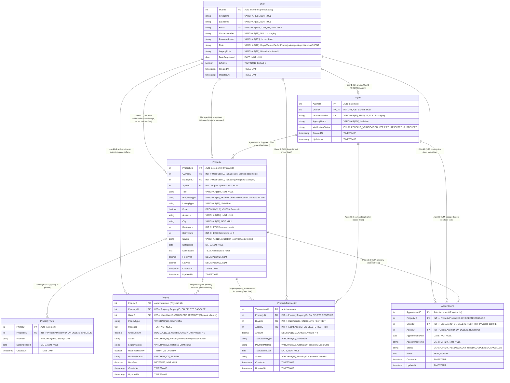

# EstateCore — Entity-Relationship Diagram (ERD) & Schema Architecture (Final Consistency Version)
### Verified Relational Schema Aligned with `estatecire.pdf` & Real-World Real Estate Domain

This document presents the revised Entity-Relationship Diagram (ERD) and relational architecture for **EstateCore**, strictly preserving the six core entities from Laboratory Activity 04 and maintaining EstateCore's supporting appointment module.

---

## 1. Visual Entity-Relationship Diagram (Mermaid)

---

## 2. Cardinality & Relational Logic

### 1. `User` &harr; `Agent` (Strict 1:1)
- **Cardinality:** Exactly zero or one `Agent` record per `User`.
- **Relational Anchor:** `Agent.UserID` is constrained as both `FOREIGN KEY` referencing `User.UserID` and `UNIQUE`.
- **Domain Meaning:** An agent is an authorized system user who has completed professional onboarding and holds licensing information. A user cannot have multiple agent profiles, and an agent profile cannot exist without a corresponding user account.
- **Verification Lifecycle:** `Agent.VerificationStatus` (`PENDING_VERIFICATION`, `VERIFIED`, `REJECTED`, `SUSPENDED`).

### 2. `User` &rarr; `Property` (1:M as Legal Owner) and `ManagerID` (1:M as Delegated Manager)
- **Cardinality:** One `User` can own zero, one, or many properties (`OwnerID`).
- **Owner vs Manager Distinction:**
  - `OwnerID`: Legal asset owner (`Seller`). Only the seller matching `OwnerID === User.UserID` can view and manage their listing.
  - `ManagerID`: Delegated property manager (`PropertyManager`). May manage only properties explicitly assigned to them (`ManagerID === User.UserID`).
- **Ownership Staging Rule:** `OwnerID` is maintained as `INT NULL` (nullable) until verified seller accounts are attached. The schema will **not** enforce `NOT NULL` on `OwnerID` until 100% of properties have verified legal owners.

### 3. `Agent` &rarr; `Property` (1:M as Listing Representative)
- **Cardinality:** One `Agent` represents zero, one, or many properties (`AgentID`).
- **Relational Anchor:** `Property.AgentID` references `Agent.AgentID` (resolved via `Agent.UserID` join).

### 4. `Property` &rarr; `PropertyPhoto` (1:M Gallery)
- **Cardinality:** One `Property` has zero, one, or many photos (`PhotoID`).
- **Referential Integrity:** `ON DELETE CASCADE` removes photo metadata when a property record is removed. Storage cleanup service deletes physical file assets.

### 5. `User` & `Property` &rarr; `Inquiry` (M:N Resolved via Junction)
- **Cardinality:** A prospective buyer or renter can inquire about multiple properties; a property can receive inquiries from multiple users.
- **Audit Preservation:** `LegacyStatus` permanently retains original CRM state; `RequiresReview` flags ambiguous records for human qualification.

### 6. `PropertyTransaction` (Multi-Entity Deal Ledger & Recurrence)
- **Cardinality:** A property can have **multiple transactions over time** (`1:M`).
- **Domain Meaning:** Rentals recur over time as successive lease terms expire. Completed transactions become immutable financial records.

### 7. `Appointment` (Tour Coordination & Concurrency-Safe Locking)
- **Cardinality:** Links `ClientID` (`User`), `AgentID` (`Agent`), and `PropertyID` (`Property`).
- **Concurrency-Safe Conflict Prevention:**
  MySQL 8.4 does not support partial unique indexes with `WHERE` clauses. Concurrency safety is achieved by acquiring an **exclusive row lock on the target Agent record** (`SELECT AgentID FROM Agent WHERE AgentID = :agentId FOR UPDATE`) inside an explicit transaction, evaluating active schedule collisions, and inserting the appointment before releasing the lock.
