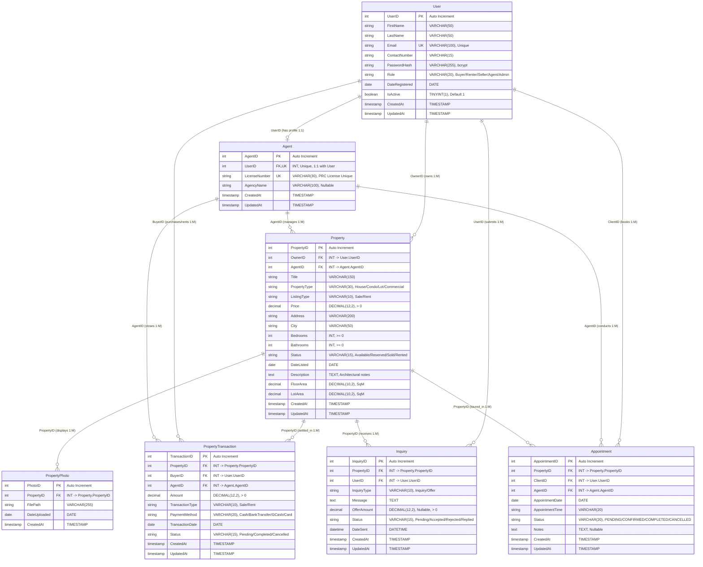

# EstateCore — Entity-Relationship Diagram (ERD) & Schema Architecture
### Normalized Relational Architecture (Laboratory Activities 03–06 & Enterprise Implementation)

This document provides the definitive visual Entity-Relationship Diagram (ERD) and relational architecture for **EstateCore**, strictly aligned with `estatecire.pdf`.

---

## 1. Visual Entity-Relationship Diagram (Mermaid)

---

## 2. Relational Cardinality & Integrity Rules

### 1. `User` &rarr; `Agent` (1:1)
- **Cardinality:** Exactly zero or one `Agent` record per `User`.
- **Enforcement:** `Agent.UserID` is constrained as `UNIQUE` and `NOT NULL` with a foreign key referencing `User.UserID`.
- **Business Rule:** An agent is a registered user with professional licensing credentials (`LicenseNumber`). A user without an agent profile cannot be assigned to manage listings or broker transactions.

### 2. `User` &rarr; `Property` (1:M as Owner)
- **Cardinality:** One `User` can own zero, one, or many properties (`OwnerID`).
- **Enforcement:** `Property.OwnerID` references `User.UserID`.
- **Business Rule:** Property ownership represents the legal deed holder, developer, or landlord (Seller/PropertyManager). The owner is distinct from the broker agent.

### 3. `Agent` &rarr; `Property` (1:M as Listing Broker)
- **Cardinality:** One `Agent` manages zero, one, or many properties (`AgentID`).
- **Enforcement:** `Property.AgentID` references `Agent.AgentID`.
- **Business Rule:** An agent handles customer inquiries, schedules tours, and updates listing metadata.

### 4. `Property` &rarr; `PropertyPhoto` (1:M)
- **Cardinality:** One `Property` has zero, one, or many photos (`PhotoID`).
- **Enforcement:** `PropertyPhoto.PropertyID` references `Property.PropertyID` with `ON DELETE CASCADE`.

### 5. `User` & `Property` &rarr; `Inquiry` (M:N resolved through junction)
- **Cardinality:** A prospective buyer/renter can send inquiries to many properties; a property receives inquiries from many users.
- **Enforcement:** `Inquiry` contains composite foreign keys `PropertyID` &rarr; `Property.PropertyID` and `UserID` &rarr; `User.UserID`.
- **Business Rule:** Supports both questions (`InquiryType = 'Inquiry'`) and price negotiations (`InquiryType = 'Offer'` with `OfferAmount > 0`).

### 6. `PropertyTransaction` Ledger (Multi-Entity Linkage)
- **Cardinality:** Links `Property` (1:M), `BuyerID` [User] (1:M), and `AgentID` [Agent] (1:M).
- **Enforcement:** All three foreign keys are `NOT NULL`.
- **Business Rule:** When a deal is marked `Completed` for a `Sale`, the linked `Property.Status` must atomically transition to `Sold`. For a `Rent`, it transitions to `Rented`.

### 7. Supporting Module: `Appointment` (1:M)
- **Cardinality:** Links prospective client (`ClientID` &rarr; `User.UserID`), property (`PropertyID` &rarr; `Property.PropertyID`), and conducting agent (`AgentID` &rarr; `Agent.AgentID`).
- **Enforcement:** Conflict prevention index prevents double booking of an agent at the same date and time.
