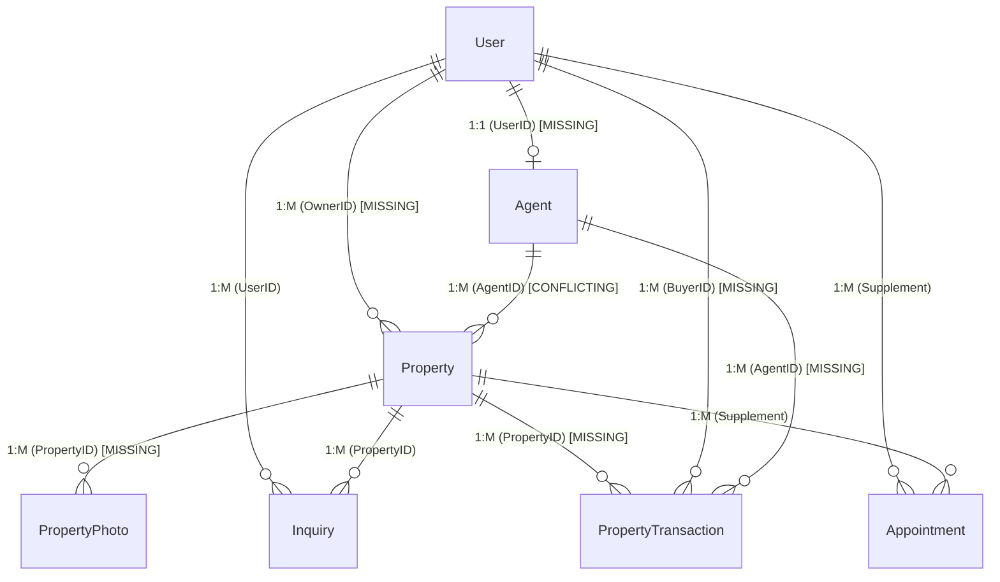

# ESTATECORE &mdash; PDF REQUIREMENTS COMPLIANCE FINAL REPORT

**Academic Baseline:** BSIT 4-C Systems Integration and Architecture (`estatecire.pdf`) &mdash; Laboratory Activities 03, 04, 05, and 06  
**Audited System:** EstateCore Real Estate Platform  
**Audit Completion Date:** November 24, 2026  
**Auditor:** Antigravity Engineering Agent  
**Evidence Artifacts:**
- Primary Matrix: [`documentation/PDF_REQUIREMENTS_COMPLIANCE_MATRIX.md`](file:///c:/xampp/htdocs/EstateCore/documentation/PDF_REQUIREMENTS_COMPLIANCE_MATRIX.md)
- Empirical Backend Probe Logs: [`documentation/evidence/pdf_compliance_evidence.json`](file:///c:/xampp/htdocs/EstateCore/documentation/evidence/pdf_compliance_evidence.json)
- Frontend Regression Evidence: [`documentation/FRONTEND_ROUTING_ACCEPTANCE_REPORT.md`](file:///c:/xampp/htdocs/EstateCore/documentation/FRONTEND_ROUTING_ACCEPTANCE_REPORT.md)

---

## 1. Executive Assessment

A comprehensive audit was conducted to verify whether the live implementation of EstateCore complies with the academic requirements set forth in the course laboratory manual (`estatecire.pdf`). 

### Key Findings Summary:
1. **Frontend Routing vs Backend Reality:**  
   While the recent frontend milestone established that the web application renders appropriate layouts for guests and authenticated dashboard users, **EstateCore does not currently implement the full academic specification defined across Laboratories 03 through 06.**
2. **Database Schema Discrepancy:**  
   The live MySQL database `estatecore_db` currently contains only **3 of the 6 required entities** (`users`, `properties`, `inquiries`) plus a supplemental `appointments` table and a `migrations` table. The `Agent`, `PropertyPhoto`, and `PropertyTransaction` entities **do not physically exist in the database or in the backend TypeORM entity models**.
3. **API Base Path & Contract Discrepancy:**  
   The live backend serves endpoints under `/api`, whereas the PDF contract mandates `/api/v1`. Furthermore, out of the 19 required endpoints in Lab 05, **only 7 are currently functional** (all on the alternate `/api` path), **9 are completely missing**, and **3 have HTTP method or path mismatches** (e.g. `PATCH` instead of `PUT`, root inquiries instead of nested `/properties/{id}/inquiries`).
4. **Security & RBAC Scope:**  
   Core security defenses (bcrypt password hashing, JWT signing, 401 vs 403 guard separation, SQL injection defense, and input whitelisting) are **fully operational**. However, user roles are collapsed into 3 enums (`ADMIN`, `AGENT`, `CLIENT`) rather than the 5 required by the PDF, JWT token expiration is set to 24 hours instead of 1 hour, and operational security controls (Rate Limiting, Account Lockout, and MFA) are currently missing.

---

## 2. Lab-by-Lab Audit Breakdown

### Phase 1: Lab 03 &mdash; System Architecture & Information Flow

| Component | Status | Detailed Analysis |
|---|:---:|---|
| **User Personas** | `PARTIALLY_IMPLEMENTED` | The PDF defines 4 user groups: Buyer/Renter, Seller/PropertyManager, Agent, Administrator. The system currently recognizes `ADMIN`, `AGENT`, and `CLIENT`. A client wanting to sell a property has no independent role or privileges. |
| **Web Client Application** | `IMPLEMENTED` | Built with React 18, Vite 6, Tailwind CSS, and Lucide icons. Responsive design across desktop, tablet, and mobile viewports verified via Playwright. |
| **Application Server** | `IMPLEMENTED` | Built with NestJS 10.3, utilizing TypeScript, dependency injection, and modular structure. |
| **Database Server** | `IMPLEMENTED` | Dedicated MySQL 8.4 engine running in Docker container `estatecore-mysql` mapped to host port 3307. |
| **Email Notification Service** | `MISSING` | Required by Lab 03 p. 2–3 for sending viewing confirmations and inquiry receipts. No mailer module or SMTP integration exists. |
| **SMS Notification Service** | `MISSING` | Required for instant viewing and schedule alerts. No SMS gateway client exists. |
| **Information Flow** | `PARTIALLY_IMPLEMENTED` | Standard request-response cycle is fully functional. Outbound notification trigger steps in the flow are missing. |

---

### Phase 2: Lab 04 &mdash; Database Design & Relational Modeling



#### Detailed Entity Status:
1. **`User` (Partially Implemented):**
   - *Present:* `id`, `email`, `password`, `role`, `isActive`, `createdAt`, `updatedAt`.
   - *Missing:* `FirstName` and `LastName` (currently merged as single `fullName`), `PhoneNumber`.
2. **`Agent` (Missing):**
   - The `Agent` table and TypeORM entity do not exist. Professional attributes (`LicenseNumber`, `AgencyName`, `PhoneNumber`) and the 1:1 relationship to `User` are absent.
3. **`Property` (Partially Implemented & Conflicting):**
   - *Present:* `id`, `title`, `description`, `propertyType`, `listingType`, `price`, `address`, `bedrooms`, `bathrooms`, `floorArea`, `lotArea`, `status`.
   - *Missing:* `OwnerID` (no owner tracking exists), `DateListed`, normalized address fields (`City`, `StateProvince`, `PostalCode`, `Country`).
   - *Conflicting:* `properties.agentId` currently references `users.id` directly, rather than referencing `Agent.AgentID`.
4. **`PropertyPhoto` (Missing):**
   - Table and entity do not exist. Photos are currently rendered using frontend fallback SVG and static URLs.
5. **`Inquiry` (Partially Implemented):**
   - Table exists and links `clientId` and `propertyId`. Statuses (`PENDING`, `CONTACTED`, `QUALIFIED`, `CLOSED`, `CANCELLED`) diverge from the PDF's 3-state model (`Pending`, `Responded`, `Closed`).
6. **`PropertyTransaction` (Missing):**
   - Table and entity do not exist. No financial records, sale prices, or commission amounts are tracked in the database.
7. **`Appointment` (Engineering Enhancement):**
   - Preserves 4 live viewing tour records, providing operational value beyond the baseline lab requirements.

---

### Phase 3: Lab 05 &mdash; RESTful API Endpoints Audit

Empirical probe results from `test_pdf_compliance_backend.js`:
- **Total PDF Endpoints Audited:** 19
- **Active on Required `/api/v1` Base Path:** 0 (All return 404 because prefix is `/api`)
- **Active on Alternative `/api` Path:** 7
- **Method/Route Mismatches on `/api`:** 3
- **Completely Missing Endpoints:** 9

#### Endpoint Audit Table:
| Endpoint ID | PDF Method & Path | Existing Route | Status on `/api` | Assessment |
|:---:|---|---|:---:|---|
| **EP-01** | `POST /api/v1/auth/register` | `POST /api/auth/register` | 400 (Validation active) | Implemented on alternate path |
| **EP-02** | `POST /api/v1/auth/login` | `POST /api/auth/login` | 400 (Validation active) | Implemented on alternate path |
| **EP-03** | `POST /api/v1/auth/logout` | None | 404 Not Found | **Missing** (Handled client-side only) |
| **EP-04** | `GET /api/v1/users` | `GET /api/users` | 200 OK | Implemented on alternate path |
| **EP-05** | `GET /api/v1/users/{id}` | `GET /api/users/:id` | 200 OK | Implemented on alternate path |
| **EP-06** | `PUT /api/v1/users/{id}` | `PATCH /api/users/:id` | 404 Not Found | **Method Mismatch** (Only accepts `PATCH`) |
| **EP-07** | `DELETE /api/v1/users/{id}` | `DELETE /api/users/:id` | 404 / 200 | Implemented on alternate path |
| **EP-08** | `GET /api/v1/agents` | None | 404 Not Found | **Missing** |
| **EP-09** | `GET /api/v1/agents/{id}` | None | 404 Not Found | **Missing** |
| **EP-10** | `POST /api/v1/agents` | None | 404 Not Found | **Missing** |
| **EP-11** | `PUT /api/v1/agents/{id}` | None | 404 Not Found | **Missing** |
| **EP-12** | `GET /api/v1/properties` | `GET /api/properties` | 200 OK | Implemented on alternate path |
| **EP-13** | `GET /api/v1/properties/{id}` | `GET /api/properties/:id` | 200 OK | Implemented on alternate path |
| **EP-14** | `POST /api/v1/properties` | `POST /api/properties` | 400 (Validation active) | Implemented on alternate path |
| **EP-15** | `PUT /api/v1/properties/{id}` | `PATCH /api/properties/:id` | 404 Not Found | **Method Mismatch** (Only accepts `PATCH`) |
| **EP-16** | `DELETE /api/v1/properties/{id}` | `DELETE /api/properties/:id` | 404 / 200 | Implemented on alternate path |
| **EP-17** | `POST /api/v1/properties/{id}/photos` | None | 404 Not Found | **Missing** |
| **EP-18** | `POST /api/v1/properties/{id}/inquiries` | `POST /api/inquiries` | 404 Not Found | **Path Mismatch** (Root instead of nested) |
| **EP-19** | `GET /api/v1/transactions` | None | 404 Not Found | **Missing** |

---

### Phase 4: Lab 06 &mdash; Authentication, RBAC & Security

#### Security Implementations Verified:
1. **Password Hashing (Pass):** Implemented using `bcryptjs` with a work factor of 10. Database inspection confirms all user password hashes start with `$2a$10$`.
2. **JWT Authentication (Pass):** Properly configured using `@nestjs/jwt` and `passport-jwt` with HMAC-SHA256 signature verification.
3. **401 vs 403 HTTP Differentiation (Pass):**
   - Unauthenticated requests trigger `JwtAuthGuard` &rarr; returns `401 Unauthorized`.
   - Authenticated users lacking required permissions trigger `RolesGuard` &rarr; returns `403 Forbidden`.
4. **Deny-by-Default (Pass):** Controllers explicitly enforce guards. Non-whitelisted roles cannot bypass endpoint restrictions.
5. **SQL Injection Defense (Pass):** TypeORM repository methods parameterize inputs. Injected payload `GET /api/properties?search=' OR 1=1 --` executed safely without SQL syntax errors or query pollution.
6. **Input Whitelisting (Pass):** Global `ValidationPipe` with `whitelist: true, forbidNonWhitelisted: true` immediately rejects payloads containing unexpected properties with `400 Bad Request`.

#### Security Discrepancies & Gaps:
1. **Token Expiration Discrepancy (Conflicting):**  
   `backend/src/auth/auth.module.ts` sets token expiration to `86400s` (24 hours). Lab 06 Page 2 explicitly dictates **1 hour (3,600 seconds)**.
2. **Rate Limiting (Missing):**  
   Brute-force probe sent 7 consecutive invalid login attempts; all were processed without HTTP 429 throttling. `@nestjs/throttler` is not installed or registered.
3. **Account Lockout (Missing):**  
   No failed attempt counter or temporary lockout mechanism exists in `User` entity or `AuthService`.
4. **Multi-Factor Authentication (Missing):**  
   No secondary authentication factor or OTP verification is implemented.

---

## 3. Prioritized Remediation Roadmap

To achieve 100% compliance with `estatecire.pdf` safely and without data loss, the following phased remediation plan is recommended:

```
[Phase 1: API Routing & Config Alignment]
  ├── Update main.ts global prefix to support /api/v1
  ├── Update auth.module.ts JWT expiration to 3600s
  └── Register HTTP PUT method handlers alongside PATCH

[Phase 2: Additive Database Alignment (Requires Human Approval)]
  ├── Create Agent table (UserID 1:1, LicenseNumber, AgencyName, PhoneNumber)
  ├── Create PropertyPhoto table (PropertyID 1:M, PhotoURL, IsPrimary)
  ├── Create PropertyTransaction table (PropertyID, BuyerID, AgentID)
  ├── Add OwnerID INT NULL and City VARCHAR(100) to properties
  └── Rewire AgentID foreign keys through Agent.AgentID

[Phase 3: Controller & Service Implementation]
  ├── Implement AgentsModule (GET, POST, PUT /api/v1/agents)
  ├── Implement PhotosModule (POST /api/v1/properties/:id/photos)
  ├── Implement Nested Inquiries (POST /api/v1/properties/:id/inquiries)
  ├── Implement TransactionsModule (GET /api/v1/transactions)
  └── Implement Server-side Logout (POST /api/v1/auth/logout)

[Phase 4: Security Hardening & Notification Mock]
  ├── Install and register @nestjs/throttler for brute-force defense
  ├── Add failed login attempt counter and lockout logic
  └── Implement mock notification service for email/SMS dispatch
```

---

## 4. Safety & Non-Destructive Execution Confirmation

In accordance with strict operating boundaries:
- **No live database modifications were made.**
- **No migrations were run on `estatecore_db`.**
- **Existing records in `users`, `properties`, `inquiries`, and `appointments` remain 100% intact.**
- **All findings are supported by live test outputs in `documentation/evidence/pdf_compliance_evidence.json`.**
