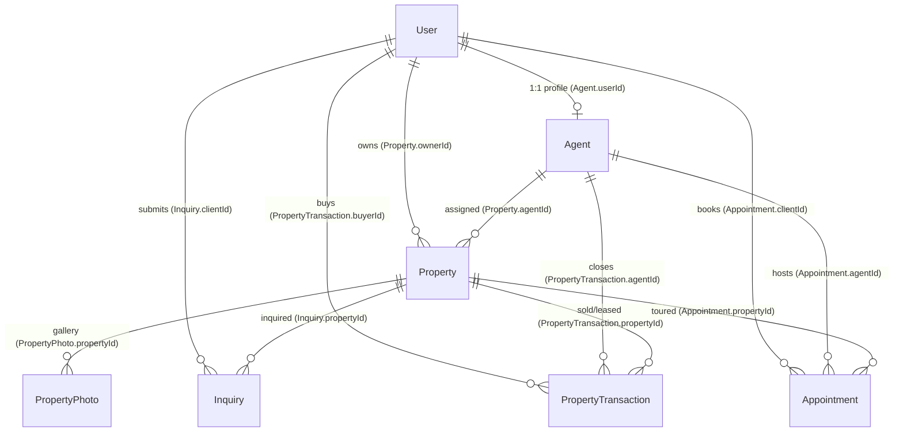

# ESTATECORE &mdash; ACADEMIC SCHEMA COMPLIANCE MATRIX (PHASE 2.1)

**Project:** EstateCore Real Estate Management Platform  
**Academic Source of Truth:** `estatecire.pdf` (BSIT 4-C Laboratory Activity 04)  
**Milestone:** Phase 2.1 &mdash; Field-Level Compliance Audit  
**Date:** November 25, 2026  
**Implementation Branch:** `feature/phase2-database-sandbox`

---

## 1. Six Core Academic Entities & Supplemental Module

This document audits the exact field-level compliance of EstateCore against Lab 04 of `estatecire.pdf`.

---

## 2. Field-Level Compliance Matrices

### 2.1 User Entity (`User` &mdash; Table `users`)

| PDF Attribute | Database Column | Data Type | Nullable | Key / Index | Academic Mapping & Rationale | Status |
|---|---|---|:---:|:---:|---|:---:|
| `UserID` | `id` | `int` | NO | PK (Auto) | Canonical primary key | **COMPLIANT** |
| `FirstName` | `firstName` | `varchar(100)` | YES | None | Deterministically populated from `fullName` | **COMPLIANT** |
| `LastName` | `lastName` | `varchar(100)` | YES | None | Deterministically populated from `fullName` | **COMPLIANT** |
| `Email` | `email` | `varchar(150)` | NO | Unique | Normalized user email credential | **COMPLIANT** |
| `ContactNumber` | `contactNumber` | `varchar(50)` | YES | None | User telephone / mobile; unverified values remain `NULL` | **COMPLIANT** |
| `PasswordHash` | `password` | `varchar(255)` | NO | None | Encrypted bcrypt hash (hidden by default in TypeORM) | **COMPLIANT** |
| `Role` | `role` | `enum` | NO | None | `ADMIN`, `AGENT`, `CLIENT` | **COMPLIANT** |
| `DateRegistered` | `createdAt` | `timestamp` | NO | None | Timestamp of account registration (`dateRegistered` getter) | **COMPLIANT** |
| *(Extension)* | `fullName` | `varchar(150)` | NO | None | Preserved for 100% frontend UI backward compatibility | **COMPLIANT** |
| *(Extension)* | `isActive` | `tinyint(1)` | NO | None | Account activation / soft lock flag | **COMPLIANT** |
| *(Extension)* | `updatedAt` | `timestamp` | NO | None | Account modification audit trail | **COMPLIANT** |

### 2.2 Agent Entity (`Agent` &mdash; Table `agents`)

| PDF Attribute | Database Column | Data Type | Nullable | Key / Index | Academic Mapping & Rationale | Status |
|---|---|---|:---:|:---:|---|:---:|
| `AgentID` | `id` | `int` | NO | PK (Auto) | Unique agent identifier | **COMPLIANT** |
| `UserID` | `userId` | `int` | NO | Unique / FK | 1:1 foreign key referencing `users.id` (`ON DELETE RESTRICT`) | **COMPLIANT** |
| `LicenseNumber` | `licenseNumber` | `varchar(50)` | YES | None | PRC license string; `NULL` until authentic credentials exist | **COMPLIANT** |
| `AgencyName` | `agencyName` | `varchar(150)` | YES | None | Brokerage firm; defaults to `'EstateCore Realty'` | **COMPLIANT** |
| *(Extension)* | `verificationStatus` | `enum` | NO | None | `PENDING_VERIFICATION`, `VERIFIED`, `REJECTED` | **COMPLIANT** |
| *(Extension)* | `specialization` | `varchar(150)` | YES | None | Commercial, residential, luxury, etc. | **COMPLIANT** |
| *(Extension)* | `createdAt` | `timestamp` | NO | None | Agent profile creation audit trail | **COMPLIANT** |
| *(Extension)* | `updatedAt` | `timestamp` | NO | None | Agent profile modification audit trail | **COMPLIANT** |

### 2.3 Property Entity (`Property` &mdash; Table `properties`)

| PDF Attribute | Database Column | Data Type | Nullable | Key / Index | Academic Mapping & Rationale | Status |
|---|---|---|:---:|:---:|---|:---:|
| `PropertyID` | `id` | `int` | NO | PK (Auto) | Unique property listing identifier | **COMPLIANT** |
| `OwnerID` | `ownerId` | `int` | YES | FK | Foreign key referencing `users.id` (`ON DELETE SET NULL`) | **COMPLIANT** |
| `AgentID` | `agentId` | `int` | YES | FK | Foreign key referencing `agents.id` (`ON DELETE SET NULL`) | **COMPLIANT** |
| `Title` | `title` | `varchar(255)` | NO | None | Listing promotional headline | **COMPLIANT** |
| `PropertyType` | `propertyType` | `enum` | NO | Index | `HOUSE`, `APARTMENT`, `CONDOMINIUM`, `COMMERCIAL`, `LAND`, `TOWNHOUSE` | **COMPLIANT** |
| `ListingType` | `listingType` | `enum` | NO | Index | `SALE`, `RENT` | **COMPLIANT** |
| `Price` | `price` | `decimal(12,2)` | NO | None | Listing asking price in PHP (₱) | **COMPLIANT** |
| `Address` | `address` | `varchar(255)` | NO | None | Physical street address | **COMPLIANT** |
| `City` | `city` | `varchar(100)` | YES | None | Normalized municipality field populated from location | **COMPLIANT** |
| `Bedrooms` | `bedrooms` | `int` | NO | None | Total bedroom count | **COMPLIANT** |
| `Bathrooms` | `bathrooms` | `int` | NO | None | Total bathroom count | **COMPLIANT** |
| `Status` | `status` | `enum` | NO | Index | `AVAILABLE`, `RESERVED`, `SOLD`, `RENTED` | **COMPLIANT** |
| `DateListed` | `createdAt` | `timestamp` | NO | None | Creation timestamp (`dateListed` getter) | **COMPLIANT** |
| *(Extension)* | `description` | `text` | NO | None | Full marketing property description | **COMPLIANT** |
| *(Extension)* | `location` | `varchar(150)` | NO | Index | Regional / neighborhood descriptor | **COMPLIANT** |
| *(Extension)* | `floorArea` | `decimal(10,2)` | NO | None | Usable floor area in square meters (sqm) | **COMPLIANT** |
| *(Extension)* | `lotArea` | `decimal(10,2)` | NO | None | Land lot area in square meters (sqm) | **COMPLIANT** |
| *(Extension)* | `updatedAt` | `timestamp` | NO | None | Property record update audit trail | **COMPLIANT** |

### 2.4 PropertyPhoto Entity (`PropertyPhoto` &mdash; Table `property_photos`)

| PDF Attribute | Database Column | Data Type | Nullable | Key / Index | Academic Mapping & Rationale | Status |
|---|---|---|:---:|:---:|---|:---:|
| `PhotoID` | `id` | `int` | NO | PK (Auto) | Unique photo identifier | **COMPLIANT** |
| `PropertyID` | `propertyId` | `int` | NO | FK / Index | FK referencing `properties.id` (`ON DELETE CASCADE`) | **COMPLIANT** |
| `FilePath` | `filePath` | `varchar(500)` | NO | None | Physical file path or stored image URL | **COMPLIANT** |
| `DateUploaded` | `createdAt` | `timestamp` | NO | None | Upload timestamp (`dateUploaded` getter) | **COMPLIANT** |
| *(Extension)* | `isPrimary` | `tinyint(1)` | NO | None | Flag identifying hero / catalog featured image | **COMPLIANT** |
| *(Extension)* | `caption` | `varchar(255)` | YES | None | Optional architectural description | **COMPLIANT** |

### 2.5 Inquiry Entity (`Inquiry` &mdash; Table `inquiries`)

| PDF Attribute | Database Column | Data Type | Nullable | Key / Index | Academic Mapping & Rationale | Status |
|---|---|---|:---:|:---:|---|:---:|
| `InquiryID` | `id` | `int` | NO | PK (Auto) | Unique inquiry lead identifier | **COMPLIANT** |
| `PropertyID` | `propertyId` | `int` | NO | FK | FK referencing `properties.id` (`ON DELETE RESTRICT`) | **COMPLIANT** |
| `UserID` | `clientId` | `int` | NO | FK | FK referencing `users.id` (`ON DELETE RESTRICT`) | **COMPLIANT** |
| `InquiryType` | `inquiryType` | `enum` | NO | None | `GENERAL`, `VIEWING`, `FINANCING`, `OFFER` | **COMPLIANT** |
| `Message` | `message` | `text` | NO | None | Inquirer’s full written communication | **COMPLIANT** |
| `OfferAmount` | `offerAmount` | `decimal(12,2)` | YES | None | Proposed financial offer in PHP (₱) | **COMPLIANT** |
| `Status` | `status` | `enum` | NO | Index | `PENDING`, `CONTACTED`, `QUALIFIED`, `CLOSED` | **COMPLIANT** |
| `DateSent` | `createdAt` | `timestamp` | NO | None | Submission timestamp (`dateSent` getter) | **COMPLIANT** |
| *(Extension)* | `legacyStatus` | `varchar(50)` | YES | None | Preserves original status verbatim without mutation | **COMPLIANT** |
| *(Extension)* | `assignedAgentId` | `int` | YES | FK | Direct routing to responding agent (`ON DELETE SET NULL`) | **COMPLIANT** |
| *(Extension)* | `subject` | `varchar(200)` | YES | None | Inquiry topic summary | **COMPLIANT** |
| *(Extension)* | `contactNumber` | `varchar(50)` | YES | None | Client callback telephone number | **COMPLIANT** |
| *(Extension)* | `updatedAt` | `timestamp` | NO | None | Status modification timestamp | **COMPLIANT** |

### 2.6 PropertyTransaction Entity (`PropertyTransaction` &mdash; Table `property_transactions`)

| PDF Attribute | Database Column | Data Type | Nullable | Key / Index | Academic Mapping & Rationale | Status |
|---|---|---|:---:|:---:|---|:---:|
| `TransactionID` | `id` | `int` | NO | PK (Auto) | Unique transaction deed identifier | **COMPLIANT** |
| `PropertyID` | `propertyId` | `int` | NO | FK / Index | FK referencing `properties.id` (`ON DELETE RESTRICT`) | **COMPLIANT** |
| `BuyerID` | `buyerId` | `int` | NO | FK / Index | FK referencing `users.id` (`ON DELETE RESTRICT`) | **COMPLIANT** |
| `AgentID` | `agentId` | `int` | NO | FK / Index | FK referencing `agents.id` (`ON DELETE RESTRICT`) | **COMPLIANT** |
| `Amount` | `amount` | `decimal(12,2)` | NO | None | Agreed closing price or rental fee in PHP (₱) | **COMPLIANT** |
| `TransactionType` | `transactionType` | `enum` | NO | None | `SALE`, `RENT` (supports recurring leases) | **COMPLIANT** |
| `PaymentMethod` | `paymentMethod` | `enum` | NO | None | `CASH`, `BANK_TRANSFER`, `CHECK`, `FINANCING` | **COMPLIANT** |
| `TransactionDate` | `transactionDate` | `date` | NO | Index | Closing date of transaction | **COMPLIANT** |
| `Status` | `status` | `enum` | NO | Index | `PENDING`, `COMPLETED`, `CANCELLED` | **COMPLIANT** |
| *(Extension)* | `notes` | `text` | YES | None | Legal escrow, notary, or agreement notes | **COMPLIANT** |
| *(Extension)* | `createdAt` | `timestamp` | NO | None | Record creation audit timestamp | **COMPLIANT** |
| *(Extension)* | `updatedAt` | `timestamp` | NO | None | Record modification audit timestamp | **COMPLIANT** |

### 2.7 Supplemental Application Entity: Appointment (`Appointment` &mdash; Table `appointments`)

| Field | Data Type | Nullable | Key / Index | Purpose | Status |
|---|---|:---:|:---:|---|:---:|
| `id` | `int` | NO | PK (Auto) | Unique viewing tour appointment identifier | **PRESERVED** |
| `propertyId` | `int` | NO | FK | FK referencing `properties.id` (`ON DELETE CASCADE`) | **PRESERVED** |
| `clientId` | `int` | NO | FK | FK referencing `users.id` (`ON DELETE CASCADE`) | **PRESERVED** |
| `agentId` | `int` | NO | FK | FK referencing `users.id` (`ON DELETE CASCADE`) | **PRESERVED** |
| `appointmentDate` | `date` | NO | Index | Scheduled viewing date | **PRESERVED** |
| `appointmentTime` | `varchar(20)` | NO | None | Scheduled viewing time slot | **PRESERVED** |
| `status` | `enum` | NO | Index | `PENDING`, `CONFIRMED`, `COMPLETED`, `CANCELLED` | **PRESERVED** |
| `notes` | `text` | YES | None | Viewing instructions or gate access notes | **PRESERVED** |
| `createdAt` / `updatedAt` | `timestamp` | NO | None | Scheduling audit timestamps | **PRESERVED** |
