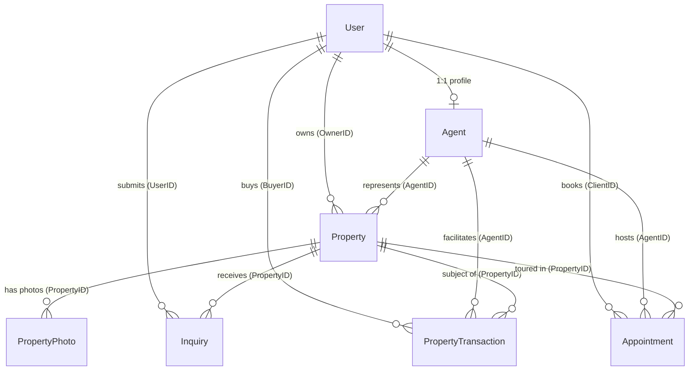

# ESTATECORE &mdash; DATABASE SCHEMA & ENTITY IMPLEMENTATION REPORT (PHASE 2C)

**Project:** EstateCore Real Estate Management Platform  
**Academic Source of Truth:** `estatecire.pdf` (BSIT 4-C Laboratory Activities 04 & 05)  
**Milestone:** Phase 2C &mdash; Core PDF Entities & Supplemental Modules  
**Date:** November 24, 2026  
**Implementation Branch:** `feature/phase2-database-sandbox`  
**Target Environment:** Isolated Sandbox (`estatecore_test_restore`)

---

## 1. Entity Implementation Architecture

EstateCore now physically defines the six mandatory core entities specified in Lab 04 of `estatecire.pdf`, while retaining the supplemental `Appointment` viewing tour module to prevent any regressions in existing platform capabilities.

---

## 2. Core Entity Definitions

### 2.1 User Entity (`User` &mdash; table `users`)
Preserves existing authentication credentials, bcrypt password hashes, and active session flags while supporting all academic relationships.
- `id` (int, PK, auto-increment) &mdash; Maps to PDF `UserID`
- `fullName` (varchar 150, not null)
- `email` (varchar 150, unique, not null)
- `password` (varchar 255, hidden by default) &mdash; Maps to PDF `PasswordHash`
- `role` (enum: `ADMIN`, `AGENT`, `CLIENT`)
- `isActive` (tinyint, default 1)
- `createdAt` (timestamp) &mdash; Maps to PDF `DateRegistered`
- `updatedAt` (timestamp)

### 2.2 Agent Entity (`Agent` &mdash; table `agents`)
Establishes the mandatory 1:1 professional identity for licensed agents.
- `id` (int, PK, auto-increment) &mdash; Maps to PDF `AgentID`
- `userId` (int, unique, not null, FK &rarr; `users.id` ON DELETE RESTRICT) &mdash; Maps to PDF `UserID`
- `licenseNumber` (varchar 50, nullable) &mdash; Set to `NULL` for existing agents until verified credentials exist
- `agencyName` (varchar 150, default `'Independent'`) &mdash; Maps to PDF `AgencyName`
- `verificationStatus` (enum: `PENDING_VERIFICATION`, `VERIFIED`, `REJECTED`)
- `specialization` (varchar 150, nullable)
- `createdAt` (timestamp)
- `updatedAt` (timestamp)

### 2.3 Property Entity (`Property` &mdash; table `properties`)
Decouples property legal ownership from commercial agency representation.
- `id` (int, PK, auto-increment) &mdash; Maps to PDF `PropertyID`
- `ownerId` (int, nullable, FK &rarr; `users.id` ON DELETE SET NULL) &mdash; Maps to PDF `OwnerID` (remains `NULL` until title deeds verified)
- `agentId` (int, nullable, FK &rarr; `agents.id` ON DELETE SET NULL) &mdash; Maps to PDF `AgentID`
- `title` (varchar 255, not null) &mdash; Maps to PDF `Title`
- `description` (text, not null)
- `propertyType` (enum: `HOUSE`, `APARTMENT`, `CONDOMINIUM`, `COMMERCIAL`, `LAND`, `TOWNHOUSE`)
- `listingType` (enum: `SALE`, `RENT`)
- `price` (decimal 12,2, not null) &mdash; Maps to PDF `Price`
- `location` (varchar 150, not null)
- `city` (varchar 100, nullable) &mdash; Normalized municipal field
- `address` (varchar 255, not null) &mdash; Maps to PDF `Address`
- `bedrooms` (int, default 1) &mdash; Maps to PDF `Bedrooms`
- `bathrooms` (int, default 1) &mdash; Maps to PDF `Bathrooms`
- `floorArea` (decimal 10,2)
- `lotArea` (decimal 10,2)
- `status` (enum: `AVAILABLE`, `RESERVED`, `SOLD`, `RENTED`) &mdash; Maps to PDF `Status`
- `createdAt` (timestamp) &mdash; Maps to PDF `DateListed`
- `updatedAt` (timestamp)

### 2.4 PropertyPhoto Entity (`PropertyPhoto` &mdash; table `property_photos`)
Stores persistent architectural imagery galleries for properties.
- `id` (int, PK, auto-increment) &mdash; Maps to PDF `PhotoID`
- `propertyId` (int, not null, FK &rarr; `properties.id` ON DELETE CASCADE) &mdash; Maps to PDF `PropertyID`
- `filePath` (varchar 500, not null) &mdash; Maps to PDF `FilePath`
- `isPrimary` (tinyint 1, default 0)
- `caption` (varchar 255, nullable)
- `createdAt` (timestamp) &mdash; Maps to PDF `DateUploaded`

### 2.5 Inquiry Entity (`Inquiry` &mdash; table `inquiries`)
Handles client communication, offers, and viewing requests against properties.
- `id` (int, PK, auto-increment) &mdash; Maps to PDF `InquiryID`
- `clientId` (int, not null, FK &rarr; `users.id` ON DELETE CASCADE) &mdash; Maps to PDF `UserID`
- `propertyId` (int, not null, FK &rarr; `properties.id` ON DELETE CASCADE) &mdash; Maps to PDF `PropertyID`
- `inquiryType` (enum: `GENERAL`, `VIEWING`, `FINANCING`, `OFFER`, default `GENERAL`)
- `assignedAgentId` (int, nullable, FK &rarr; `users.id` ON DELETE SET NULL)
- `subject` (varchar 200, nullable)
- `message` (text, not null) &mdash; Maps to PDF `Message`
- `offerAmount` (decimal 12,2, nullable) &mdash; Maps to PDF `OfferAmount`
- `contactNumber` (varchar 50, nullable)
- `status` (enum: `PENDING`, `CONTACTED`, `QUALIFIED`, `CLOSED`) &mdash; Maps to PDF `Status`
- `legacyStatus` (varchar 50, nullable) &mdash; Preserves historical status verbatim
- `createdAt` (timestamp) &mdash; Maps to PDF `DateSent`
- `updatedAt` (timestamp)

### 2.6 PropertyTransaction Entity (`PropertyTransaction` &mdash; table `property_transactions`)
Records immutable financial transactions, purchase deeds, and recurring lease agreements.
- `id` (int, PK, auto-increment) &mdash; Maps to PDF `TransactionID`
- `propertyId` (int, not null, FK &rarr; `properties.id` ON DELETE RESTRICT) &mdash; Maps to PDF `PropertyID`
- `buyerId` (int, not null, FK &rarr; `users.id` ON DELETE RESTRICT) &mdash; Maps to PDF `BuyerID`
- `agentId` (int, not null, FK &rarr; `agents.id` ON DELETE RESTRICT) &mdash; Maps to PDF `AgentID`
- `amount` (decimal 12,2, not null) &mdash; Maps to PDF `Amount`
- `transactionType` (enum: `SALE`, `RENT`) &mdash; Maps to PDF `TransactionType`
- `paymentMethod` (enum: `CASH`, `BANK_TRANSFER`, `CHECK`, `FINANCING`) &mdash; Maps to PDF `PaymentMethod`
- `status` (enum: `PENDING`, `COMPLETED`, `CANCELLED`) &mdash; Maps to PDF `Status`
- `transactionDate` (date, not null) &mdash; Maps to PDF `TransactionDate`
- `notes` (text, nullable)
- `createdAt` (timestamp)
- `updatedAt` (timestamp)

### 2.7 Supplemental Entity: Appointment (`Appointment` &mdash; table `appointments`)
Retained intact from the existing EstateCore deployment:
- `id` (int, PK, auto-increment)
- `propertyId` (int, FK &rarr; `properties.id` ON DELETE CASCADE)
- `clientId` (int, FK &rarr; `users.id` ON DELETE CASCADE)
- `agentId` (int, FK &rarr; `users.id` ON DELETE CASCADE)
- `appointmentDate` (date)
- `appointmentTime` (varchar 20)
- `status` (enum: `PENDING`, `CONFIRMED`, `COMPLETED`, `CANCELLED`)
- `notes` (text, nullable)
- `createdAt` / `updatedAt` (timestamp)
