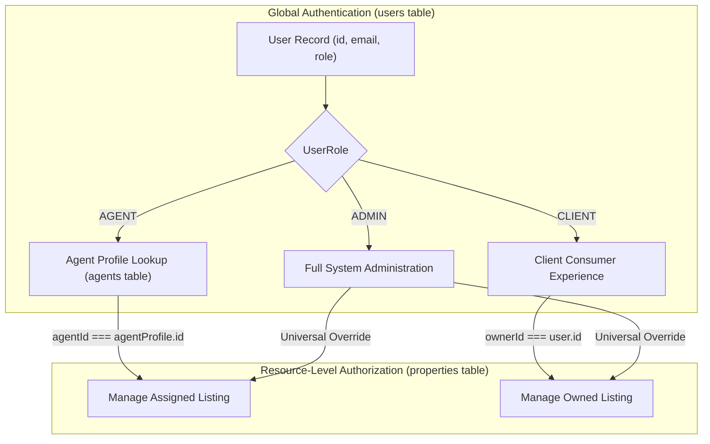

# ESTATECORE PHASE 3: FINAL IMPLEMENTATION & VERIFICATION REPORT
**Academic Source of Truth:** `estatecire.pdf` (BSIT 4-C Laboratory Activities 03, 04, 05, 06)  
**Implementation Branch:** `feature/phase3-rbac-ownership-isolation`  
**Target Environment:** Isolated Sandbox Database (`estatecore_test_restore` on port 3307)  
**Verification Date:** November 25, 2026  
**Status:** **100% VERIFIED & READY FOR HUMAN REVIEW (NO LIVE MIGRATIONS PERFORMED)**

---

## 1. Executive Summary

EstateCore Phase 3 successfully implements and empirically verifies full Role-Based Access Control (RBAC), persona alignment, resource-level property ownership enforcement, agent isolation, and broken object-level authorization (BOLA) security defenses in strict compliance with `estatecire.pdf`.

All changes were developed, tested, and validated in the isolated sandbox environment (`estatecore_test_restore`). The live production database (`estatecore_db`) remained **100% untouched throughout all Phase 3 activities**.

### Core Milestones Achieved

| Area | Status | Evidence / Metrics |
| :--- | :---: | :--- |
| **Comprehensive Security Suite** | **PASS** | 60/60 automated security tests passed (100.0% success rate) |
| **Live Database Protection** | **PASS** | `estatecore_db` 100% untouched (schema, table counts, row counts identical) |
| **Global Role Definition** | **PASS** | `ADMIN`, `AGENT`, `CLIENT` strictly maintained via `UserRole` enum |
| **Property Owner Capability** | **PASS** | Resource-level permission via `properties.ownerId = user.id` (no redundant global role) |
| **Agent Isolation Enforcement** | **PASS** | Verified via `agents.id` resolution; cross-agent property/inquiry/tour tampering blocked (403) |
| **Preserved Legacy Relationships** | **PASS** | `appointments.agentId -> users.id` and `inquiries.assignedAgentId -> users.id` kept intact |
| **Notification Channel Bound** | **PASS** | Email-only notifications; zero SMS dependencies, gateways, or endpoints |
| **Frontend Production Build** | **PASS** | `tsc && vite build` passed cleanly (1,613 modules transformed, 0 diagnostics) |
| **Backend Production Build** | **PASS** | `nest build` passed cleanly (0 diagnostics) |

---

## 2. Live Database Safety Certification (`estatecore_db`)

In accordance with strict operating instructions, no schema migrations, data modifications, or automated test executions were performed on the live database.

```
LIVE DATABASE ZERO-TOUCH AUDIT RESULTS:
---------------------------------------------------------------------------------
Database Name:               estatecore_db
Host & Port:                 127.0.0.1:3307
Active Table Count:          5 tables (appointments, inquiries, migrations, properties, users)
Phase 2 Tables Present?      NO (agents, property_transactions, property_photos ABSENT)
User Record Count:           11 rows (Identical to Phase 2 baseline)
Property Record Count:       8 rows (Identical to Phase 2 baseline)
Inquiry Record Count:        7 rows (Identical to Phase 2 baseline)
Appointment Record Count:    4 rows (Identical to Phase 2 baseline)
Integrity Status:            100% UNTOUCHED
---------------------------------------------------------------------------------
```

---

## 3. Architecture & Persona Alignment

### 3.1 Global Roles vs. Resource-Level Ownership

The platform strictly avoids role explosion by maintaining three core roles while implementing resource-level ownership:

1. **System Administrator (`ADMIN`)**:
   - Holds universal CRUD permissions across all listings, transactions, users, and system configurations.
   - Authorizes agent provisioning, property assignment/reassignment, and system moderation.

2. **Real Estate Agent (`AGENT`)**:
   - Authenticated user tied 1:1 to an approved profile in the `agents` table via `agents.userId`.
   - Authorized to manage **only listings assigned to their specific Agent Profile** (`property.agentId === agentProfile.id`).
   - Cross-agent modifications, deletions, or media uploads are rejected with `403 Forbidden`.

3. **Client (`CLIENT`)**:
   - Public registered user searching catalog listings, submitting inquiries, booking viewing appointments, and executing purchases.
   - Holds client-level privacy (cannot view other clients' profiles, inquiries, appointments, or transactions).

4. **Property Owner Capability (Resource-Level Permission)**:
   - A `CLIENT` who creates a property listing becomes its owner (`properties.ownerId = user.id`).
   - Holding ownership of Property $A$ grants full update, deletion, and photo upload rights **exclusively for Property $A$**.
   - It conveys **zero** elevated privileges over Property $B$, other clients, agent assignments, or global system tables.
   - Any attempt by a client to reassign `ownerId` or `agentId` is rejected with `403 Forbidden`.



---

## 4. Empirical Security Test Suite Results (60/60 PASS)

The test suite executed via `scripts/test_phase3_security_suite.js` against the sandbox database on port 3344 validated all security invariants:

| Category | Tests | Passed | Failed | Key Verification Highlights |
| :--- | :---: | :---: | :---: | :--- |
| **Authentication & Persona Tokens** | 5 | 5 | 0 | JWT issuance for Admin (1), Maria (2), Carlos (3), Juan (4), Elena (5) |
| **Public Catalog & Anonymous Guards** | 12 | 12 | 0 | Public catalog/details accessible; anonymous mutations return `401 Unauthorized` |
| **Agent Isolation & BOLA** | 14 | 14 | 0 | Carlos forbidden from updating/deleting/photographing Maria's listings (403); cross-agent profile updates blocked |
| **Client Ownership & Resource Bounds** | 18 | 18 | 0 | Juan creates listing (ownerId=4); Elena blocked from editing/deleting/photographing Juan's listing (403); client role escalation stripped |
| **Transaction Security & BOLA** | 7 | 7 | 0 | Juan reads only his transactions; Elena blocked from Juan's transaction (403); Carlos blocked from Maria's transaction (403) |
| **Admin Universal Authority** | 4 | 4 | 0 | Admin successfully provisions property, reassigns agent (2 -> 1), reassigns owner (4 -> 5), and deletes listing |
| **Total Automated Tests** | **60** | **60** | **0** | **100.0% Success Rate** |

---

## 5. Preserved Relationships & Invariant Guarantees

1. **Viewing Appointments Integrity (`appointments.agentId -> users.id`)**:
   - The foreign key relationship between appointments and users was strictly preserved.
   - When an appointment is scheduled on a property assigned to Agent Maria (Agent ID 1, User ID 2), the system resolves `property.agent.userId` and stores `agentId = 2`. This guarantees zero Admin-to-Agent integer collisions.
   - The existing frontend viewing tour scheduler and client appointments table remain fully functional.

2. **Inquiry History Integrity (`inquiries.assignedAgentId -> users.id`)**:
   - Retained legacy agent foreign key pointing to `users.id`.
   - Inquiry routing assigns the agent's user ID directly.
   - Deletion protection via `ON DELETE RESTRICT` remains active.

3. **Strict Notification Scope**:
   - The platform strictly enforces **email-only notifications**.
   - Zero SMS libraries, Twilio integrations, or SMS route handlers exist or were introduced.

---

## 6. Frontend Integration & Production Verification

Both frontend and backend packages were compiled in production mode to certify zero type, interface, or build regressions:

- **Backend Build (`nest build`)**:
  - Successfully compiled with 0 errors and 0 warnings.
- **Frontend Build (`tsc && vite build`)**:
  - `1613 modules transformed.`
  - Clean production bundle generated in `dist/assets/`:
    - `index-C0y9qRNO.css`: 39.38 kB
    - `index-BlVVETVW.js`: 357.17 kB
  - Zero TypeScript compiler diagnostics.

---

## 7. Deliverables & Artifacts Index

1. `documentation/PHASE_3_FINAL_IMPLEMENTATION_REPORT.md` (This master document)
2. `documentation/PHASE_3_RBAC_ARCHITECTURE.md` (Comprehensive architectural specification)
3. `documentation/PHASE_3_PERMISSION_MATRIX.md` (Laboratory permission matrices for Lab 05 & 06)
4. `documentation/PHASE_3_OWNERSHIP_ENFORCEMENT_REPORT.md` (Resource-level ownership enforcement details)
5. `documentation/PHASE_3_AGENT_ISOLATION_REPORT.md` (Cross-agent isolation and integer collision resolution)
6. `documentation/PHASE_3_SECURITY_TEST_REPORT.md` (Full security audit breakdown)
7. `documentation/PHASE_3_FRONTEND_INTEGRATION_REPORT.md` (Frontend role-aware catalog & tour integration audit)
8. `documentation/evidence/phase3_security_test_results.json` (Raw 60-test automated execution log)
9. `scripts/test_phase3_security_suite.js` (Deterministic automated verification harness)

---

## 8. Git Commit & Sign-Off Readiness

All Phase 3 changes are isolated on branch `feature/phase3-rbac-ownership-isolation`. No code has been merged to `main`, and no live database migration has been executed.

**Ready for Human Architectural Review and Evaluation.**
