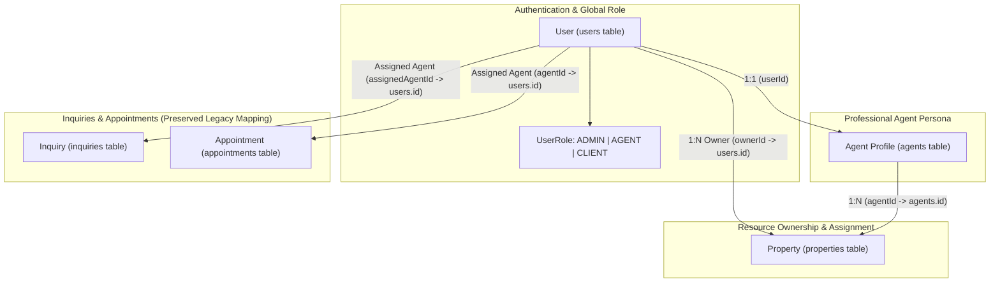

# ESTATECORE PHASE 3: RBAC ARCHITECTURE SPECIFICATION
**Academic Alignment:** `estatecire.pdf` &mdash; Lab 03 (System Architecture), Lab 05 (REST API Contract), Lab 06 (Role-Based Access Control)  
**Implementation Branch:** `feature/phase3-rbac-ownership-isolation`  
**Execution Environment:** Isolated Sandbox Database (`estatecore_test_restore`)

---

## 1. Architectural Philosophy: Roles vs. Resource-Level Permissions

In strict adherence to the academic source of truth (`estatecire.pdf`) and the user's architectural corrections:
1. **Global Application Roles (`UserRole` Enum):**
   - The platform defines three mutually exclusive system roles:
     - `ADMIN`: Full administrative oversight, agent provisioning, user moderation, transaction audit.
     - `AGENT`: Professional real estate agent bound to an approved `agents` profile.
     - `CLIENT`: Registered public user participating in property searches, inquiries, viewings, and purchases.
2. **The "Property Owner" Persona is a Resource-Level Permission, Not a Separate Global Role:**
   - In accordance with the user's explicit guidance, property owners are **NOT** assigned a redundant global role (`SELLER` or `OWNER`).
   - A property owner is modeled as a `CLIENT` who holds the foreign key `properties.ownerId = user.id`.
   - Ownership of Property $A$ grants full CRUD and media management rights **over Property $A$ only**.
   - It conveys **zero** administrative or agent privileges over other properties, users, or platform operations.
3. **Agent Isolation via Relational Mapping (`agents.userId`):**
   - Professional agent permissions are decoupled from user primary keys.
   - An authenticated agent with `user.id` resolves their professional identity via `agents.findOne({ where: { userId: user.id } })`.
   - All assigned listings must satisfy `property.agentId === agentProfile.id`.
   - Direct integer comparisons between `property.agentId` and `user.id` have been eradicated.

---

## 2. Guard, Decorator & Pipeline Implementation

The authorization pipeline consists of three defensive tiers:

### Tier 1: Authentication Guard (`JwtAuthGuard`)
- Validates the incoming JWT bearer token in the `Authorization` header.
- Enforces token expiration (1-hour TTL).
- Validates against token revocation (blacklisted JTI on logout).
- Attaches the authenticated `User` entity to `request.user`.

### Tier 2: Role Guard (`RolesGuard`)
- Evaluates the `@Roles(...)` metadata attached to controllers and route handlers.
- Grants immediate entry if the user's role is in the allowed set.
- Rejects unpermitted roles with `403 Forbidden`.

### Tier 3: Service-Level Ownership & BOLA Defense
- Executed inside the service methods (`PropertiesService`, `InquiriesService`, `AppointmentsService`, `TransactionsService`, `AgentsService`).
- Verifies resource ownership before executing mutations or returning private records:
  - Property updates: `property.ownerId === user.id` OR `property.agentId === agentProfile.id` OR `user.role === 'ADMIN'`.
  - Photo upload: `property.ownerId === user.id` OR `property.agentId === agentProfile.id` OR `user.role === 'ADMIN'`.
  - Inquiries: `inquiry.clientId === user.id` OR `inquiry.assignedAgentId === user.id` OR `inquiry.property.ownerId === user.id` OR `user.role === 'ADMIN'`.
  - Appointments: `appointment.clientId === user.id` OR `appointment.agentId === user.id` OR `user.role === 'ADMIN'`.
  - Transactions: `tx.buyerId === user.id` OR `tx.agentId === agentProfile.id` OR `user.role === 'ADMIN'`.
  - Agent profile updates: `agent.userId === user.id` OR `user.role === 'ADMIN'`.

---

## 3. Data Integrity & Reassignment Protection

Privilege escalation through payload tampering is strictly blocked:
- Non-administrators (Agents and Clients) who attempt to supply `agentId` or `ownerId` in `UpdatePropertyDto` payloads are intercepted and rejected with `403 Forbidden`.
- In `PropertiesService.update`, `agentId` and `ownerId` fields are stripped from non-admin updates, preventing unauthorized listing transfers.
- Non-administrators who attempt to update their own `role` or `isActive` status via `PATCH /users/:id` are blocked; the service strips privileged administrative fields.
