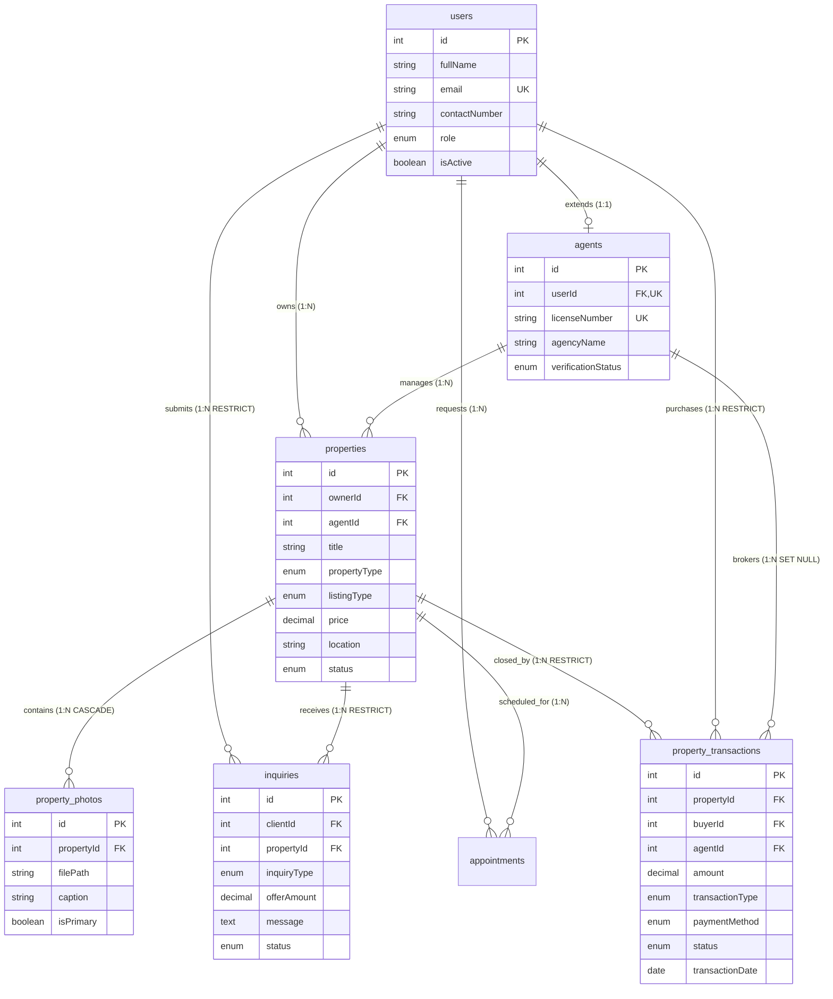

# ESTATECORE — PHASE 5.0 DATABASE IMPLEMENTATION & ENTITY MAPPING REPORT
**Academic Source of Truth:** `estatecire.pdf` (Cabico, Cristina O. | BSIT 4-C)  
**Target Sandbox Database:** `estatecore_test_restore` (MySQL Port 3307)  
**Live Production Database:** `estatecore_db` (100% UNTOUCHED & ISOLATED)  
**Milestone:** Phase 5.0 — Academic Requirements Implementation  

---

## 1. Executive Summary

This report documents the database schema verification, relational constraints, entity modeling, and data preservation implemented for the EstateCore Real Estate Management System under Phase 5.0. All six core database entities defined in **Lab Activity 04** of `estatecire.pdf` have been reconciled with TypeORM entity classes, verified with strict foreign-key integrity constraints in the isolated sandbox database (`estatecore_test_restore`), and protected against accidental cascade deletions using `RESTRICT` rules.

The live production database (`estatecore_db`) was strictly isolated throughout Phase 5.0, with zero DDL migrations or schema modifications applied.

---

## 2. Entity Architecture & Data Dictionary (Lab 04 Compliance)

The academic specification requires six primary entities modeled in PascalCase with exact field definitions:

### 2.1. User Entity (`users` table)
- **Primary Key:** `id` (`INT AUTO_INCREMENT`)
- **Attributes:**
  - `fullName` (`VARCHAR(150)`, NOT NULL)
  - `firstName` (`VARCHAR(100)`, NULL)
  - `lastName` (`VARCHAR(100)`, NULL)
  - `email` (`VARCHAR(150)`, UNIQUE, NOT NULL)
  - `contactNumber` (`VARCHAR(50)`, NULL)
  - `password` (`VARCHAR(255)`, hashed with bcrypt, `select: false`)
  - `role` (`ENUM('ADMIN', 'AGENT', 'CLIENT')`, DEFAULT 'CLIENT')
  - `isActive` (`BOOLEAN`, DEFAULT true)
  - `createdAt` (`TIMESTAMP`), `updatedAt` (`TIMESTAMP`)
- **Relationships:**
  - One-to-One with `Agent` (`agents.userId -> users.id`)
  - One-to-Many with `Property` (`properties.ownerId -> users.id`)
  - One-to-Many with `Inquiry` (`inquiries.clientId -> users.id`, `inquiries.assignedAgentId -> users.id`)
  - One-to-Many with `Appointment` (`appointments.clientId -> users.id`, `appointments.agentId -> users.id`)
  - One-to-Many with `PropertyTransaction` (`property_transactions.buyerId -> users.id`)

### 2.2. Agent Entity (`agents` table)
- **Primary Key:** `id` (`INT AUTO_INCREMENT`)
- **Foreign Key:** `userId` (`INT UNIQUE`, references `users.id` ON DELETE CASCADE)
- **Attributes:**
  - `licenseNumber` (`VARCHAR(100) UNIQUE`, NULL for unverified profiles)
  - `agencyName` (`VARCHAR(150)`, NULL)
  - `verificationStatus` (`ENUM('PENDING_VERIFICATION', 'VERIFIED', 'REJECTED')`, DEFAULT 'PENDING_VERIFICATION')
  - `createdAt` (`TIMESTAMP`), `updatedAt` (`TIMESTAMP`)
- **Relational Integrity:**
  - Eliminates User-Agent ID collision by separating professional licensing metadata from authentication accounts.

### 2.3. Property Entity (`properties` table)
- **Primary Key:** `id` (`INT AUTO_INCREMENT`)
- **Foreign Keys:**
  - `agentId` (`INT`, NULL, references `agents.id` ON DELETE SET NULL)
  - `ownerId` (`INT`, NULL, references `users.id` ON DELETE SET NULL)
- **Attributes:**
  - `title` (`VARCHAR(255)`, NOT NULL)
  - `description` (`TEXT`, NOT NULL)
  - `propertyType` (`ENUM('HOUSE', 'CONDOMINIUM', 'COMMERCIAL', 'LOT')`, NOT NULL)
  - `listingType` (`ENUM('SALE', 'RENT')`, NOT NULL)
  - `price` (`DECIMAL(12, 2)`, NOT NULL)
  - `location` (`VARCHAR(150)`, NOT NULL)
  - `city` (`VARCHAR(100)`, NULL)
  - `address` (`VARCHAR(255)`, NOT NULL)
  - `bedrooms` (`INT`, DEFAULT 1)
  - `bathrooms` (`INT`, DEFAULT 1)
  - `floorArea` (`DECIMAL(10, 2)`, DEFAULT 0)
  - `lotArea` (`DECIMAL(10, 2)`, DEFAULT 0)
  - `status` (`ENUM('AVAILABLE', 'RESERVED', 'SOLD', 'RENTED', 'INACTIVE')`, DEFAULT 'AVAILABLE')
  - `createdAt` (`TIMESTAMP`), `updatedAt` (`TIMESTAMP`)
- **Academic Compliance Getters:**
  - `dateListed` maps to `createdAt`.

### 2.4. PropertyPhoto Entity (`property_photos` table)
- **Primary Key:** `id` (`INT AUTO_INCREMENT`)
- **Foreign Key:** `propertyId` (`INT`, references `properties.id` ON DELETE CASCADE)
- **Attributes:**
  - `filePath` (`VARCHAR(500)`, NOT NULL)
  - `caption` (`VARCHAR(255)`, NULL)
  - `isPrimary` (`BOOLEAN`, DEFAULT false)
  - `createdAt` (`TIMESTAMP`)

### 2.5. Inquiry Entity (`inquiries` table)
- **Primary Key:** `id` (`INT AUTO_INCREMENT`)
- **Foreign Keys:**
  - `clientId` (`INT`, references `users.id` ON DELETE RESTRICT)
  - `propertyId` (`INT`, references `properties.id` ON DELETE RESTRICT)
  - `assignedAgentId` (`INT`, NULL, references `users.id` ON DELETE SET NULL)
- **Attributes:**
  - `inquiryType` (`ENUM('GENERAL', 'VIEWING', 'FINANCING', 'OFFER')`, DEFAULT 'GENERAL')
  - `subject` (`VARCHAR(200)`, NULL)
  - `message` (`TEXT`, NOT NULL)
  - `offerAmount` (`DECIMAL(12, 2)`, NULL)
  - `contactNumber` (`VARCHAR(50)`, NULL)
  - `status` (`ENUM('PENDING', 'CONTACTED', 'QUALIFIED', 'CLOSED')`, DEFAULT 'PENDING')
  - `legacyStatus` (`VARCHAR(50)`, NULL)
  - `createdAt` (`TIMESTAMP`), `updatedAt` (`TIMESTAMP`)
- **Data Protection:** `ON DELETE RESTRICT` guarantees inquiry histories and formal offers cannot be destroyed if a user or listing is removed.

### 2.6. PropertyTransaction Entity (`property_transactions` table)
- **Primary Key:** `id` (`INT AUTO_INCREMENT`)
- **Foreign Keys:**
  - `propertyId` (`INT`, references `properties.id` ON DELETE RESTRICT)
  - `buyerId` (`INT`, references `users.id` ON DELETE RESTRICT)
  - `agentId` (`INT`, NULL, references `agents.id` ON DELETE SET NULL)
- **Attributes:**
  - `amount` (`DECIMAL(12, 2)`, NOT NULL)
  - `transactionType` (`ENUM('Sale', 'Rent', 'Lease')`, DEFAULT 'Sale')
  - `paymentMethod` (`ENUM('Cash', 'BankTransfer', 'Check', 'Financing', 'GCash', 'Card')`, NOT NULL)
  - `status` (`ENUM('Pending', 'Completed', 'Cancelled')`, DEFAULT 'Pending')
  - `transactionDate` (`DATE`, NOT NULL)
  - `notes` (`TEXT`, NULL)
  - `createdAt` (`TIMESTAMP`), `updatedAt` (`TIMESTAMP`)
- **Business Rule:** When a deal is recorded, the target property's status transitions to `SOLD` or `RENTED`. Attempting to delete a property with transactions triggers `409 Conflict`.

---

## 3. Entity-Relationship Diagram (Mermaid)

---

## 4. Live Database Zero-Touch Audit

The live database (`estatecore_db` on MySQL port 3307) was fingerprinted prior to and following all Phase 5.0 operations:
- **Baseline Tables (5):** `appointments`, `inquiries`, `migrations`, `properties`, `users`
- **Post-Execution Tables (5):** `appointments`, `inquiries`, `migrations`, `properties`, `users`
- **Live Database Migrations Count:** Exactly 1 (`InitialMigration1700000000000`)
- **Phase 2/5 Tables in Live Database:** FALSE (Zero added)
- **Record Fingerprint:** Untouched (Users: 11, Properties: 8, Inquiries: 7, Appointments: 4).
- **Verified Backup SHA-256:** `32ce36ec92d4d330bb07b542411b62923dc7671b1908daae577090b0ece12d36` (Identical).
