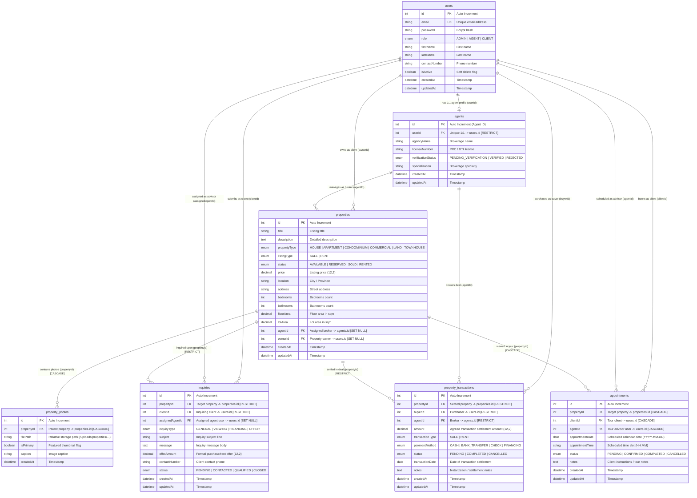

# EstateCore Developer Guide: Database & Entity Relationship Guide

**Project:** EstateCore — Real Estate Management System  
**Academic Course:** ITEC 116 — Systems Integration and Architecture 2  
**Database Management System:** MySQL 8.4 LTS  
**Port:** Host `3307` -> Container `3306`  
**Storage Engine:** InnoDB (Strict Foreign Keys, ACID Compliance)  
**Academic Reference:** `estatecire.pdf` (Lab 04: Database Design & Entity Relationships)  

---

## 1. Entity-Relationship Diagram (ERD)



---

## 2. Vital Identity Disambiguation Guide

A frequent source of defects in legacy real estate platforms is confusing user accounts with professional agent profiles. In EstateCore, these ID namespaces are strictly segregated:

```
┌─────────────────────────────────┐       1:1       ┌─────────────────────────────────┐
│              users              │ ─────────────── │             agents              │
├─────────────────────────────────┤                 ├─────────────────────────────────┤
│ id = 2  (Maria Santos)          │                 │ id = 1  (Professional Profile)  │
│ email = maria.santos@...        │                 │ userId = 2  (Foreign Key)       │
│ role = 'AGENT'                  │                 │ licenseNumber = 'PRC-0012345'   │
└─────────────────────────────────┘                 └─────────────────────────────────┘
```

### Critical Rules for Developers & Integrators:
1. **`users.id` vs `agents.id`:**
   - `users.id` represents authentication credentials, email, password hash, and global role (`AGENT`).
   - `agents.id` represents the professional brokerage profile (license, bio, agency name).
   - For Maria Santos: `users.id` is **2**, while `agents.id` is **1**.
   - For Carlos Reyes: `users.id` is **3**, while `agents.id` is **2**.
2. **`properties.agentId` references `agents.id`:**
   - When Maria Santos creates a listing, `properties.agentId` must be stored as **`1`** (her `agents.id`), NOT `2`.
   - The backend `PropertiesService` automatically resolves this mapping via `this.agentsRepo.findOne({ where: { userId: user.id } })`.
3. **`properties.ownerId` references `users.id`:**
   - When a client (e.g. Juan Dela Cruz, `users.id = 4`) lists an ancestral estate, `properties.ownerId = 4` and `agentId = NULL`.
4. **`appointments.agentId` and `inquiries.assignedAgentId` reference `users.id`:**
   - For scheduling and messaging notification, appointments and inquiries link directly to the agent's user account (`users.id = 2`).
5. **`property_transactions.agentId` references `agents.id`:**
   - Audited financial deal settlements record the broker profile (`agents.id = 1`).

---

## 3. Foreign Key Constraints & Referential Deletion Actions (All 13 Foreign Keys)

| # | Table | Constraint Name | Column | References | On Delete Action | Business Reason |
| :- | :--- | :--- | :--- | :--- | :--- | :--- |
| 1 | `agents` | `FK_agents_userId` | `userId` | `users(id)` | **`RESTRICT`** | **Strict Identity Protection:** An agent profile cannot be deleted or orphaned while active foreign key dependencies exist. |
| 2 | `properties` | `FK_properties_agentId` | `agentId` | `agents(id)` | `SET NULL` | Removing an agent unassigns the listing rather than deleting the property. |
| 3 | `properties` | `FK_properties_ownerId` | `ownerId` | `users(id)` | `SET NULL` | Deleting a user account unassigns legal ownership rather than deleting the listing. |
| 4 | `property_photos` | `FK_property_photos_propertyId` | `propertyId` | `properties(id)` | `CASCADE` | Deleting a property automatically cascades and cleans up all attached media metadata. |
| 5 | `inquiries` | `FK_inquiries_propertyId` | `propertyId` | `properties(id)` | **`RESTRICT`** | **Inquiry Protection:** Prevents deleting a property if prospective buyers have submitted active inquiries. |
| 6 | `inquiries` | `FK_inquiries_clientId` | `clientId` | `users(id)` | **`RESTRICT`** | Protects prospect communication audit history from client account deletion. |
| 7 | `inquiries` | `FK_inquiries_assignedAgentId` | `assignedAgentId` | `users(id)` | `SET NULL` | If an assigned advisor account is deactivated, the inquiry remains open for reassignment. |
| 8 | `appointments` | `FK_appointments_propertyId` | `propertyId` | `properties(id)` | `CASCADE` | Deleting an unlisted property cancels scheduled viewing tour appointments. |
| 9 | `appointments` | `FK_appointments_clientId` | `clientId` | `users(id)` | `CASCADE` | Removing a client cancels their pending viewing appointments. |
| 10 | `appointments` | `FK_appointments_agentId` | `agentId` | `users(id)` | `CASCADE` | Removing an advisor cancels tour appointments scheduled under their calendar. |
| 11 | `property_transactions` | `FK_transactions_propertyId` | `propertyId` | `properties(id)` | **`RESTRICT`** | **Financial Integrity:** Deleting a property that has an existing sales transaction is strictly blocked by the database engine. |
| 12 | `property_transactions` | `FK_transactions_buyerId` | `buyerId` | `users(id)` | **`RESTRICT`** | Purchaser audit records cannot be deleted. |
| 13 | `property_transactions` | `FK_transactions_agentId` | `agentId` | `agents(id)` | **`RESTRICT`** | Settled broker commission records cannot be deleted. |

---

## 4. Third Normal Form (3NF) Normalization Proof

EstateCore satisfies 3NF normalization rules across all tables:
1. **First Normal Form (1NF):** All tables have a primary key, each column stores atomic values (no repeating groups or arrays stored as unindexed blobs), and each row is unique.
2. **Second Normal Form (2NF):** Every table is in 1NF, and all non-key attributes are fully functionally dependent on the primary key (no partial key dependencies).
3. **Third Normal Form (3NF):** Every table is in 2NF, and no transitive dependencies exist (non-prime attributes depend only on the primary key). For instance, agent brokerage attributes (`agencyName`, `licenseNumber`, `specialization`) are segregated into the `agents` table rather than denormalized across `users` or `properties`.
